# Android TV UIスナップショット — 2026年10月27日

[全プラットフォームの収録一覧](../../README.md) · [スマートフォン版の同日記録](../../android/2026-10-27/README.md) · [メタデータ](manifest.json) · [撮影時のフォーカス記録](capture-details.json)

Android TV専用のシステムイメージで実UIを撮影した16枚です。スマートフォン版と同じ製品コミット・APKを使い、TVホームの案内、USBの入口、D-pad操作時のフォーカスを記録しました。原寸PNGの合成・リサイズ・描き直しは行っていません。

## 収録条件

| 項目 | 値 |
|---|---|
| 撮影日時 | 2026-10-27 22:30:57〜22:31:19（日本時間） |
| 参照版 | [Android 268d99c](https://github.com/mnagata/ContinuousPlayer_for_Android/commit/268d99cbc2a3de2662210229dc7c4c267dcde375)、Debug / 1.0 (1) |
| 製品ソース・APK | 製品ソースは参照コミットと一致。スマートフォン版と同じAPK SHA-256をmanifestに記録 |
| 実行環境 | Android TV Emulator、Android 16 / API 36、arm64-v8a、Emulator 37.2.12.0 |
| システムイメージ | `system-images;android-36;android-tv;arm64-v8a` revision 4。TVモードを確認、アプリ内のモード差し替えなし |
| 画面 | 1920×1080px、320dpi、OS構成960×540dp、横向き固定 |
| 文字・言語 | 文字倍率1.0、OS en-US、アプリはデフォルトの日本語リソース |
| 外観 | 暗色。スマートフォンのステータスバー・ナビゲーションバーなし |
| 入力 | D-padの上下・決定・戻る・Escを注入。一部の撮影開始位置はフォーカスを指定 |
| 撮影 | UiAutomation.takeScreenshot、未加工PNG。画像ごとの時刻・最前面ウィンドウの実フォーカスも保存 |
| 検証 | ビルド成功、[撮影ハーネス OK (1 test)](capture-result.txt)、16枚を目視確認 |

## 撮影用データと準備方法

スマートフォン版と同じ `UI Sample` のサンプルを使用しています。動画は幾何学模様の90秒・640×360・24fps・音声なし、音声は90秒・48kHz・mono・16bitの無音WAVです。同名異形式の `Sample OP.mp4` / `Sample OP.wav` と子フォルダー `Season 2` を用意しました。

保存済み一覧のUSB表記は、アプリ専用領域をUSB形式のモデルへ登録した撮影用データです。実USB機器は使用していません。再生はハーネスから製品の `startPlayback` を呼び、実プレイヤーでサンプルを再生しています。

ホーム→保存済み一覧、追加先→USB案内、再生→情報／ファイル一覧は実UIの経路を使います。登録解除の確認はListViewの製品側長押しコールバックで表示しています。一部のボタンフォーカスは `requestFocus()` で準備するため、物理リモコンでの一連の操作や長押し時間を検証した記録ではありません。

## TVホーム

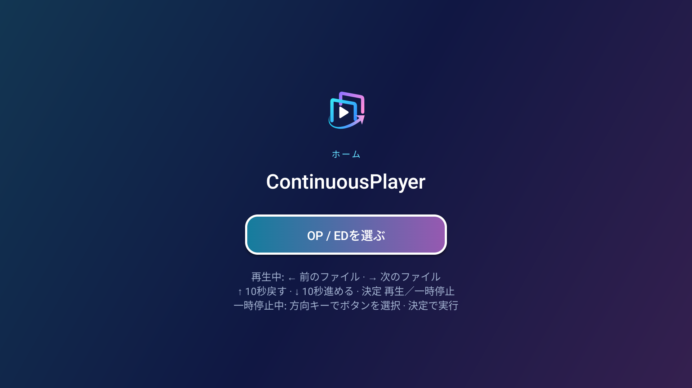

「OP / EDを選ぶ」に白いフォーカス枠を表示します。下のTV用案内には、再生中の左右＝前後ファイル、上下＝±10秒、決定＝再生／一時停止と、一時停止中のボタン移動を記載しています。

## 保存済みフォルダー

| 保存済み0件・追加にフォーカス | 保存済み1件・行を選択 |
|---|---|
| 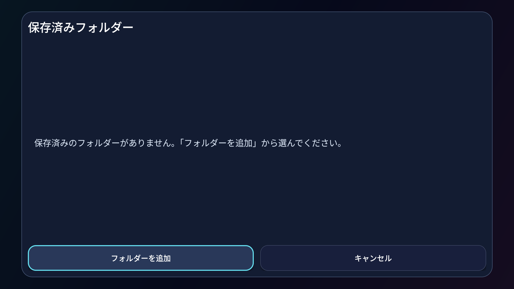 | 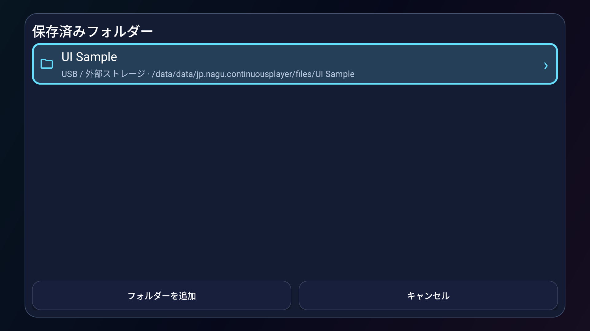 |

1件の場合も一覧を表示します。リスト行や追加ボタンはシアンの枠で選択状態を示します。

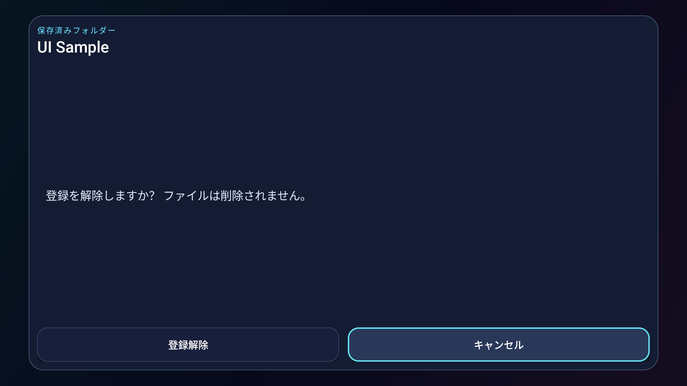

登録解除は確認だけを表示し、確定していません。「ファイルは削除されません」の説明があり、キャンセルにフォーカスを置きます。

## TVの追加先とUSBアクセス案内

| USB行を選択 | 決定後のアクセス案内 |
|---|---|
| 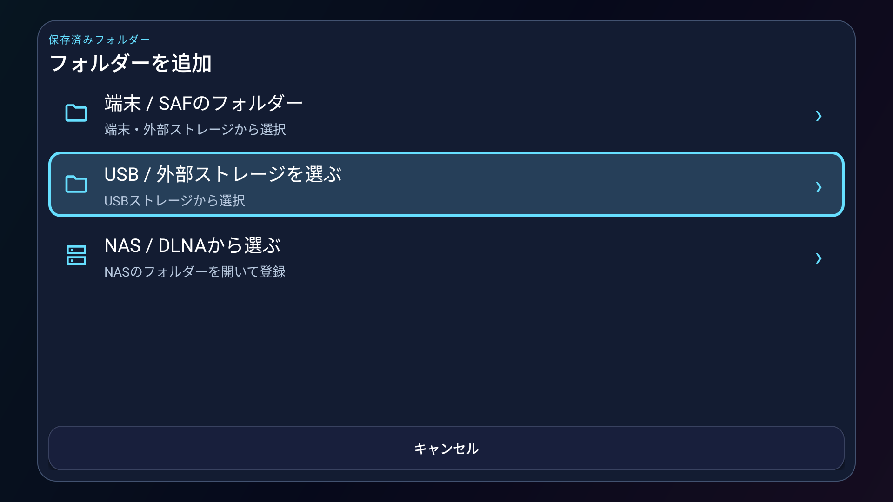 | 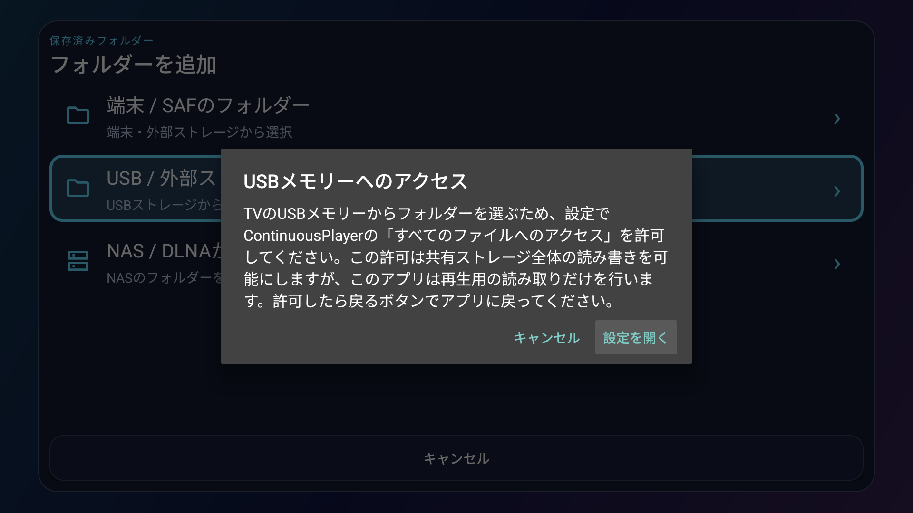 |

TVでは「端末 / SAF」「USB / 外部ストレージ」「NAS / DLNA」の3つの入口を表示します。USB行で決定するとアクセスの案内を表示し、「設定を開く」にフォーカスが移ります。設定を開く操作や権限付与は実行していません。

## 動画の一時停止とボタン移動

| 再生ボタンにフォーカス | 上キーで情報ボタンへ移動 |
|---|---|
| 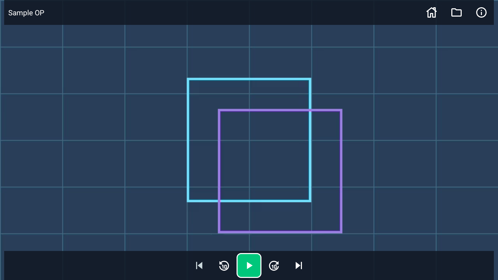 | 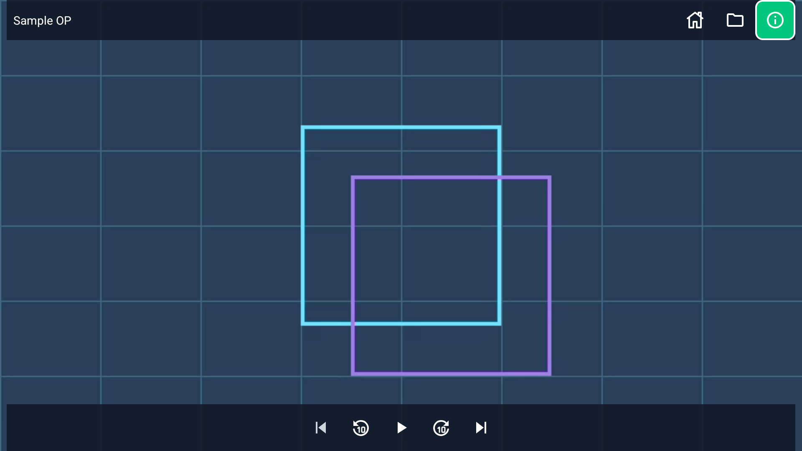 |

上端に左寄せタイトルと右側のホーム・ファイル一覧・メディア情報、下端中央に5つの再生操作を表示します。再生から上キーを押すと情報ボタンへ移動し、選択中のボタンが緑色になります。2件キューの先頭なので、前のファイルは無効です。

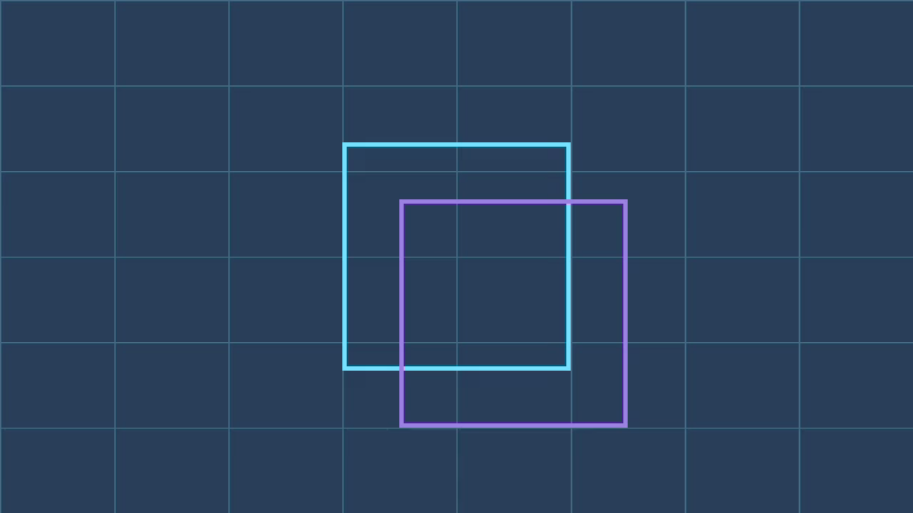

再生中は操作部を隠し、映像だけを表示します。`tv-unfocused` は操作ボタンを選択していない状態を表し、キー入力先は `player_view` です。格子と2つの枠は撮影用動画の内容です。

## 再生から開くファイル一覧

| 開いた直後・子フォルダーを選択 | 下キー後・MP4行を選択 |
|---|---|
| 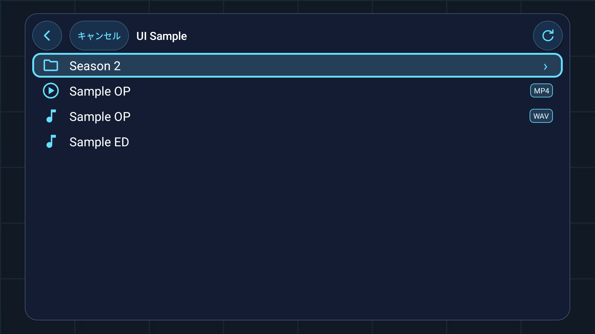 | 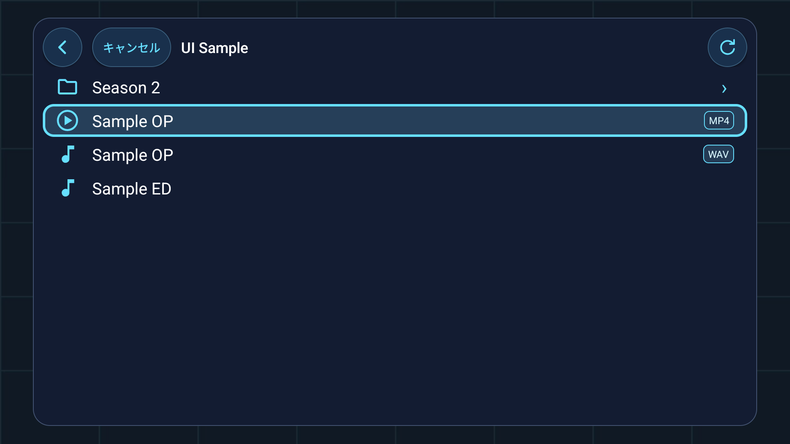 |

再生画面の戻るキーで開いた共通ブラウザーです。今回の撮影用セッションでは、直後に `Season 2` 行の選択枠が表示され、下キーで `Sample OP` のMP4行へ移動しました。実際に写った選択位置を記録しており、現在ファイルへの自動選択の保証を示すものではありません。

表示名の拡張子を省略し、同名になる動画・音声にはMP4 / WAVバッジを付けます。フォルダーと動画・音声のアイコンも区別しています。

## 音声の再生と終了

| 音声再生中・一時停止にフォーカス | 最後まで再生・再生にフォーカス |
|---|---|
| 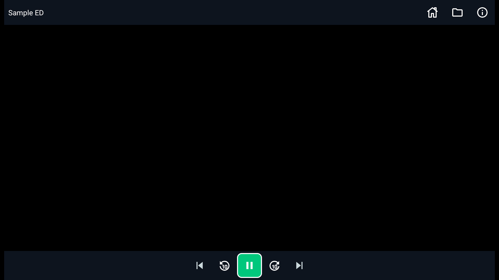 | 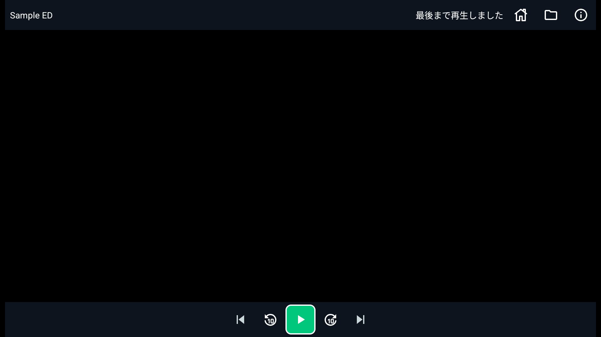 |

音声のみでもタイトルと操作部を常時表示します。単一キューのため前後ボタンは無効です。終了時は「最後まで再生しました」と再生アイコンを表示します。

## メディア情報

| 動画 | 音声・スクロール上端 |
|---|---|
| 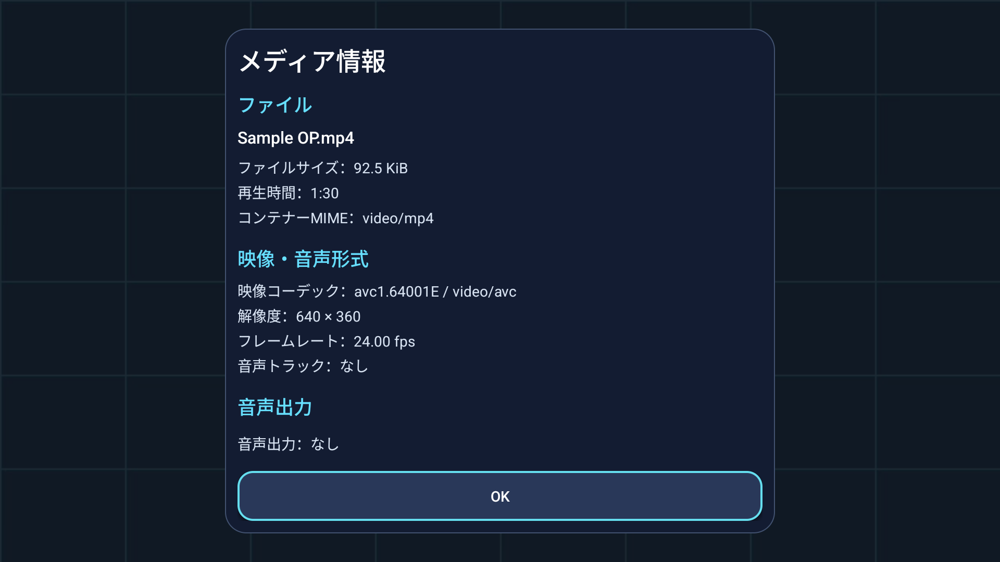 | 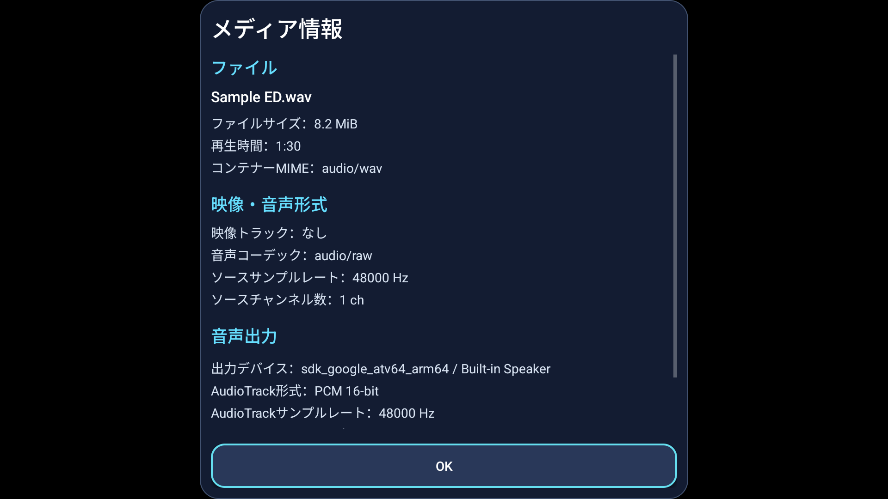 |

OKにシアンのフォーカス枠を表示します。動画は形式・解像度・フレームレートと音声なしの情報、音声はソース形式と実際のAudioTrack情報を表示しています。

音声情報は縦方向にスクロールでき、撮影位置では音声出力情報の後半が表示領域外です。スクロール後の画面は未収録です。出力先はTVエミュレーターの内蔵スピーカーであり、実USB DACの測定結果ではありません。

## 再生エラー

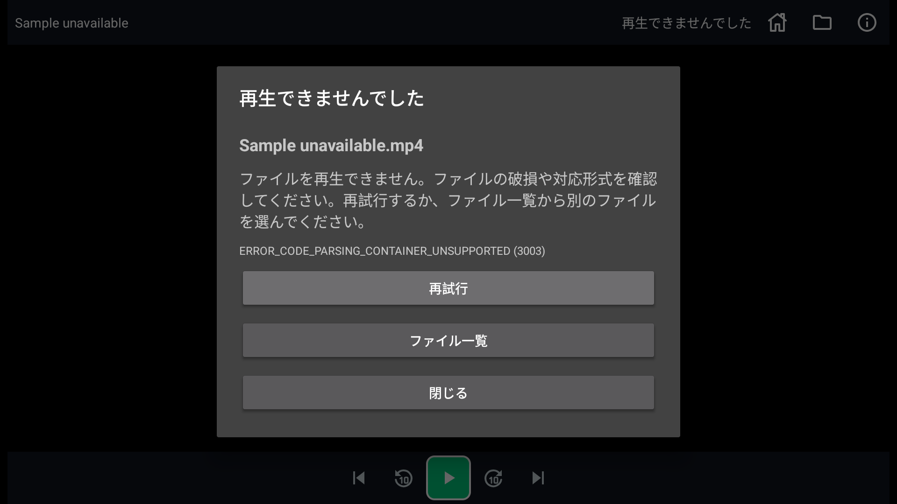

不正なMP4サンプルによる実際のコンテナ解析失敗です。元の名前、理由、エラーコード3003と、再試行・ファイル一覧・閉じるを表示します。再試行へ撮影準備でフォーカスを指定しており、背景が明るくなっています。単一キューのため「次へ」は表示されません。

## 未収録範囲

| 対象 | 理由 |
|---|---|
| 実TV・4K・オーバースキャン・文字拡大 | 1080pエミュレーター、文字倍率1.0だけを収録 |
| 実USB・OS権限設定・USBドライブ一覧 | 権限の案内のみ収録し、実機器や設定変更を伴う操作は未実施 |
| DLNA探索・手入力・接続失敗 | 実NASは未接続 |
| SAFシステム選択画面 | アプリ側の入口のみ収録 |
| 一覧の空・読み込み・失敗 | ファイル一覧は通常の内容ありだけを収録。保存済み一覧は空も収録 |
| 音声情報のスクロール下部 | 上端の画面だけを収録 |
| シーク不可・長いタイトル・中断復帰 | 今回のサンプル外 |

未収録は未実装を意味しません。画像は撮影時点のUIの記録であり、共通操作仕様への準拠・実機の入力や再生品質を保証しません。

## 関連資料

- [撮影手順・エミュレーター条件・撮影ハーネス](../../../tools/android/README.md)
- [共通操作仕様](../../../docs/common-operation-spec.md)
- [同じ参照版のプラットフォーム比較](../../../docs/platform-ui-operation-comparison-2026-10-27.md)
- [固定コミットの画面・TVホーム](https://github.com/mnagata/ContinuousPlayer_for_Android/blob/268d99cbc2a3de2662210229dc7c4c267dcde375/app/src/main/res/layout/activity_main.xml)
- [固定コミットのTV判定・入力・再生状態](https://github.com/mnagata/ContinuousPlayer_for_Android/blob/268d99cbc2a3de2662210229dc7c4c267dcde375/app/src/main/java/jp/nagu/continuousplayer/MainActivity.kt)
