# Android UIスナップショット — 2026年10月27日

[全プラットフォームの収録一覧](../../README.md) · [記録形式](../../format.md) · [機械可読メタデータ](manifest.json)

現行Android版の実UIをエミュレーターで撮影した15枚です。サンプルデータを使い、画像の合成・リサイズ・描き直しは行っていません。共通仕様の採用案や、他OSの実装済み画面とは区別して扱います。

## 収録条件

| 項目 | 値 |
|---|---|
| 撮影日時 | 2026-10-27 22:13頃（日本時間）。画像内の時刻はエミュレーター側の表示 |
| 参照版 | [Android 268d99c](https://github.com/mnagata/ContinuousPlayer_for_Android/commit/268d99cbc2a3de2662210229dc7c4c267dcde375)、Debug / 1.0 (1) |
| ソース | 製品ソースは参照コミットと一致。撮影専用コードのみandroidTestへ一時配置 |
| 実行環境 | Medium_Phone_API_36.1、Android 16 / API 36.1、arm64-v8a、Emulator 37.2.12.0 |
| 画面 | 縦1080×2400px／横2400×1080px、420dpi。縦のOS構成値411×914dp |
| 文字・言語 | 文字倍率1.0、OS en-US、アプリはデフォルトの日本語リソース |
| 外観・入力 | アプリ暗色／OS通常外観。View操作・タッチ・長押しで準備。リストの初期選択表示を含む |
| システム領域 | ホーム・ダイアログではシステムバーを含む。再生は全画面。OS初回案内は通常操作で閉じる |
| 撮影 | UiAutomation.takeScreenshotによる原寸PNG。寸法・SHA-256はmanifestに保存 |
| 検証 | APK・撮影用APKのビルド成功。撮影ハーネス OK (1 test)、15枚を目視確認 |

## 撮影用データと画面遷移

`UI Sample` に幾何学模様の動画（90秒、640×360、24fps、音声なし）、無音WAV（90秒、48kHz、mono、16bit）、同名異形式のファイル、子フォルダーを置きました。実在の作品・NAS名・個人ファイルは使用していません。

ホーム → 保存済みフォルダー → 長押しの登録解除確認、またはフォルダーを追加 → 保存元の選択、を実際の操作で撮影しています。登録解除は確定していません。

再生は撮影ハーネスでサンプルキューを設定して実プレイヤーを開始し、再生画面 → ファイル一覧／メディア情報、を実UIで開きます。ファイル一覧は、再生からの選び直しに使う共通ブラウザーです。保存済み行のUSB表記は撮影用モデルによるもので、実USBの接続を示しません。

## ホーム

| 縦 | 横 |
|---|---|
| 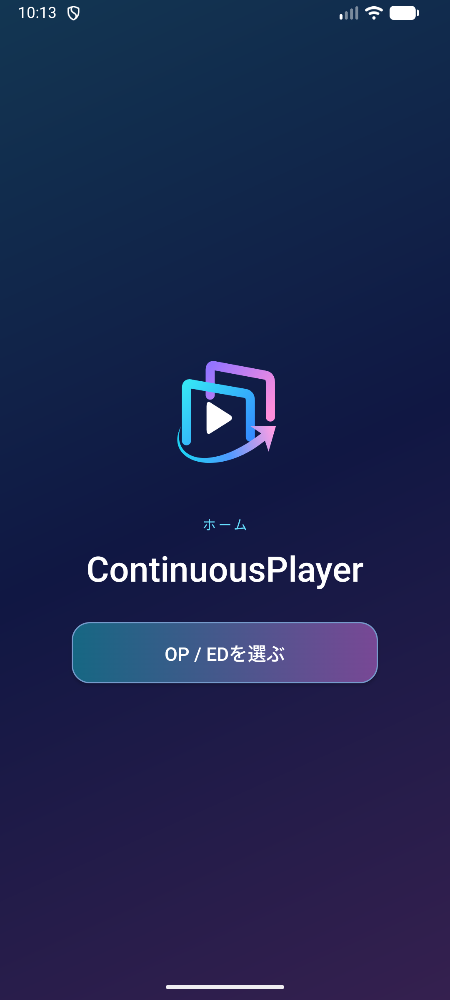 | 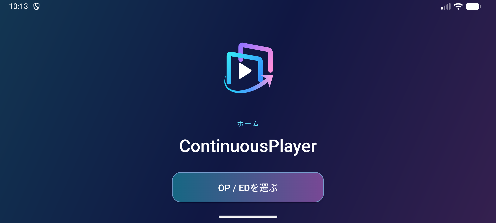 |

ロゴ、アプリ名、主要な選択ボタンを中央に配置します。横向きではロゴと余白が小さくなります。

## 保存済みフォルダーと登録解除

| 保存済み一覧 | 長押し後の確認 |
|---|---|
| 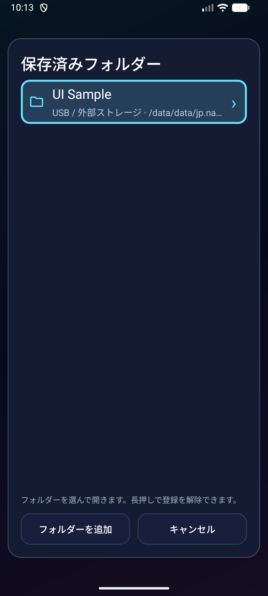 | 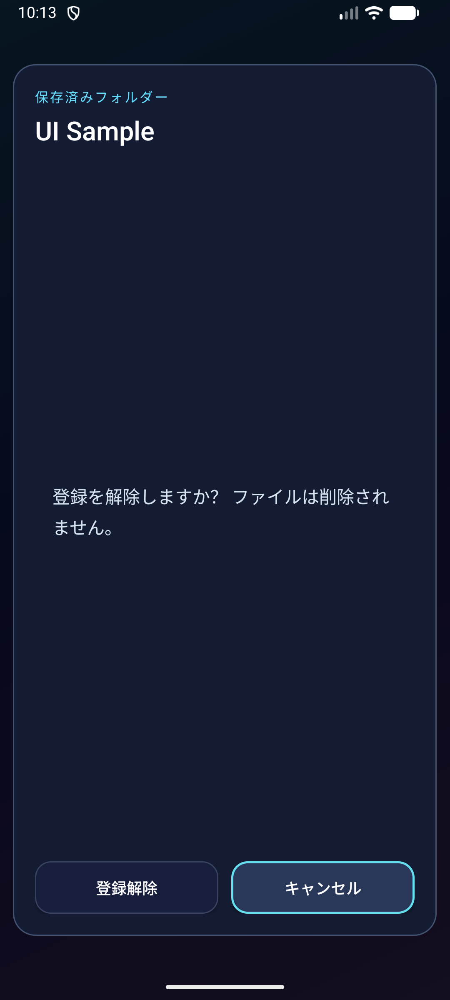 |

保存済みが1件でも一覧を表示します。登録解除の確認には「ファイルは削除されません」と表示され、キャンセルにフォーカスが置かれています。

## フォルダーの追加先

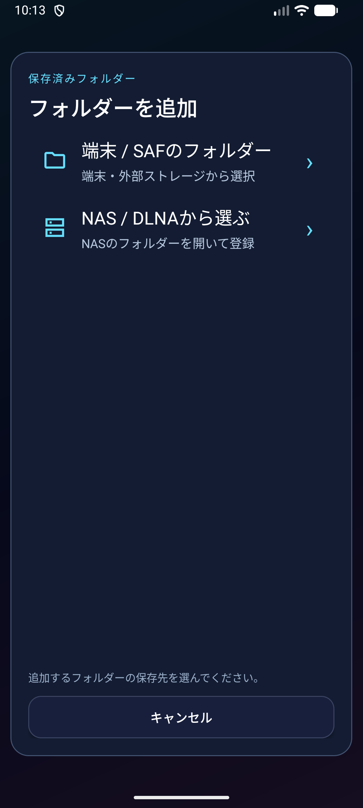

スマートフォン版ではSAFとNAS / DLNAの2つの入口を表示します。TV専用のUSB入口はこの画像の対象外です。

## 再生から開くファイル一覧

| 縦 | 横 |
|---|---|
| 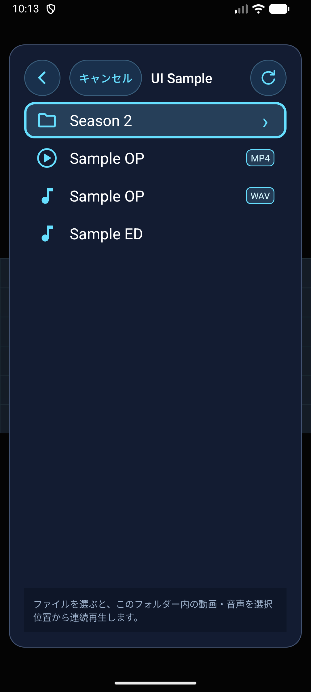 | 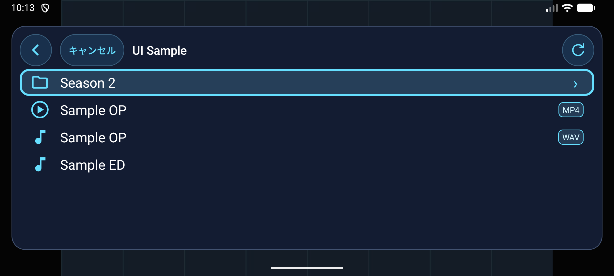 |

上部に上へ・キャンセル・タイトル・再読み込みを並べます。子フォルダー、動画、音声をアイコンで区別し、表示名が同じ `Sample OP` にMP4 / WAVの形式バッジを表示します。撮影時は子フォルダー行に初期選択が見えています。

## 動画の再生・一時停止

| 縦・一時停止 | 横・一時停止 |
|---|---|
| 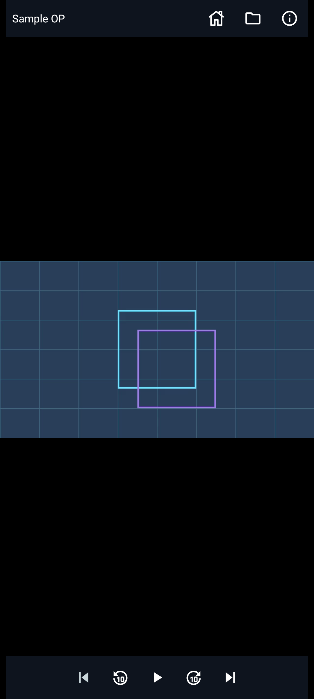 | 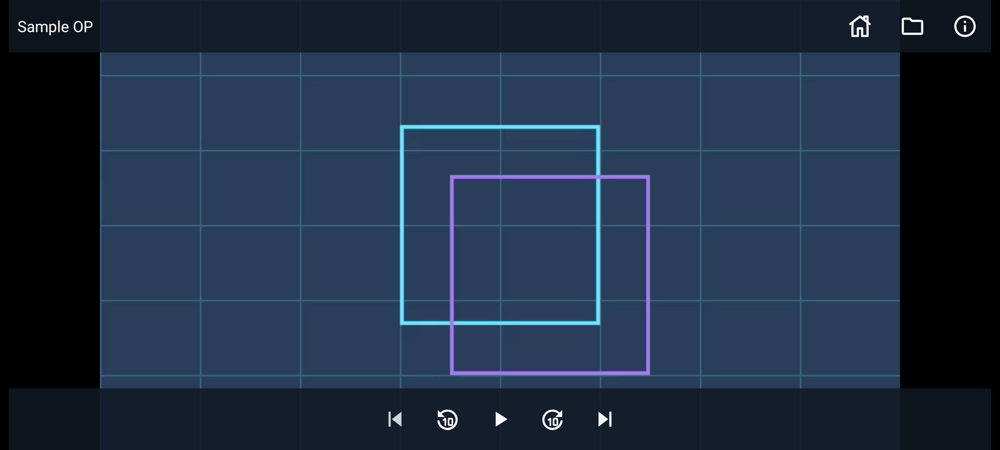 |

上端には左のタイトルと右のホーム・ファイル一覧・メディア情報、下端中央には前・−10秒・再生・＋10秒・次の5操作を表示します。2件キューの先頭なので前のファイルは無効です。映像のアスペクト比を保ち、縦向きは上下、横向きは左右に黒い余白があります。

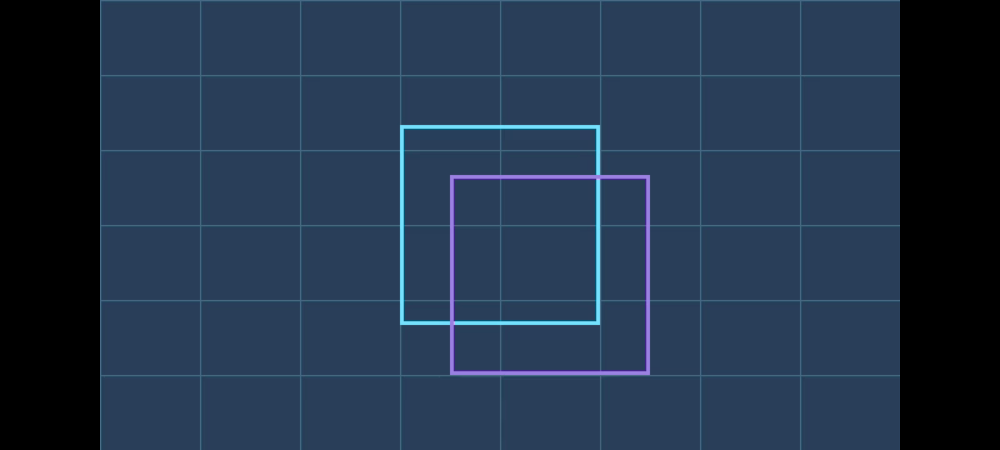

動画の再生中は操作部が隠れます。背景の格子と2つの枠は、UIではなく撮影用動画の内容です。

## 音声の再生・終了

| 音声再生中 | 最後まで再生 |
|---|---|
| 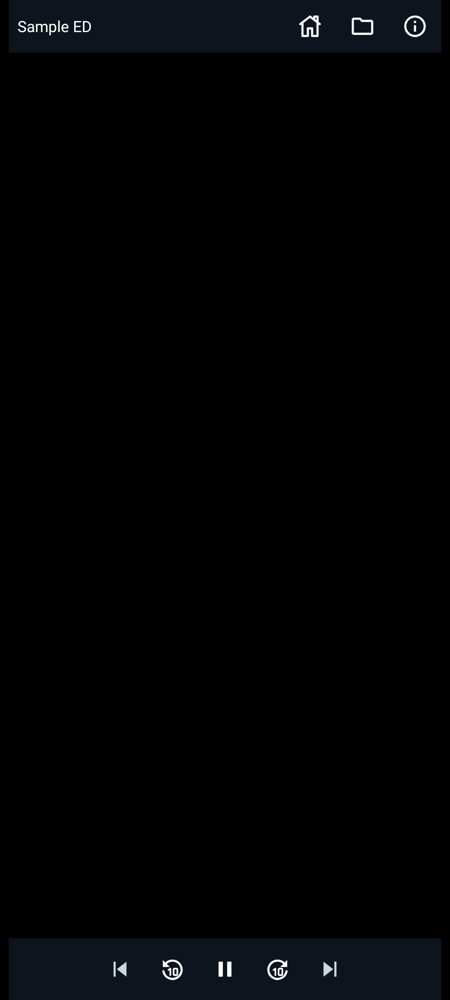 | 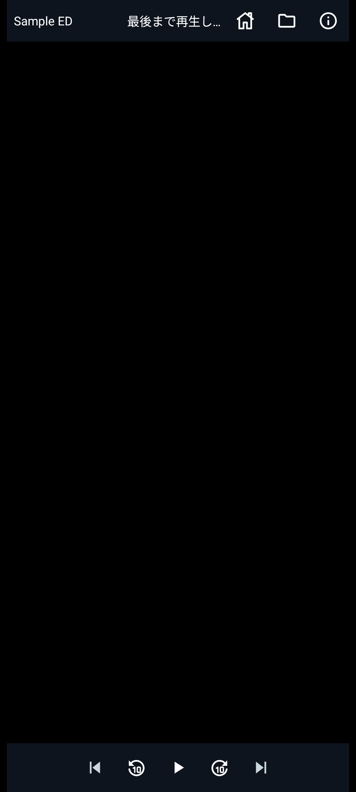 |

音声だけの場合もタイトルと操作部を表示します。1件キューなので前後ボタンは無効です。終了後は上端に状態文を表示し、中央アイコンは再生になります。縦画面では状態文の末尾が表示幅に応じて省略されています。

## メディア情報

| 動画 | 音声 |
|---|---|
| 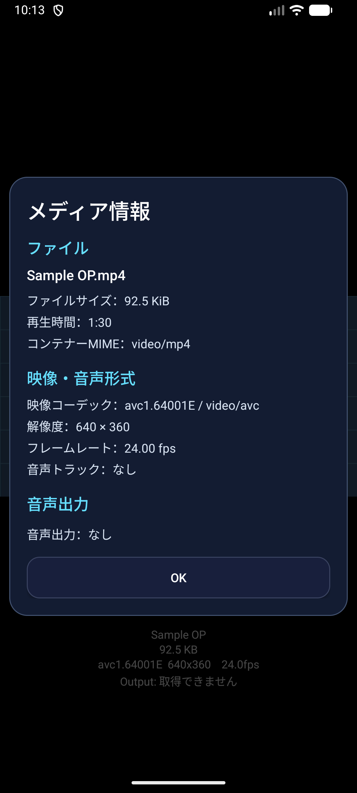 | 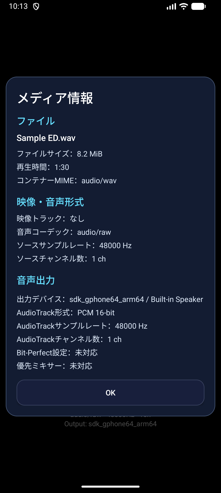 |

ファイル → 映像・音声形式 → 音声出力の順で表示します。動画は音声なし、音声はソース形式と実際のAudioTrackを分けて表示しています。出力値はエミュレーターの結果であり、実USB DACの動作を示しません。

## 再生エラー

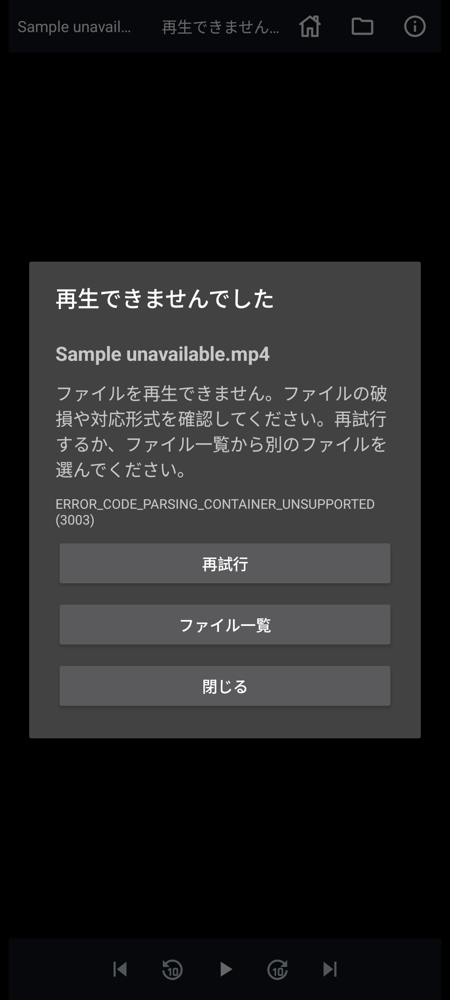

不正なMP4サンプルによるコンテナ解析失敗です。ファイル名、理由、エラーコード、再試行・ファイル一覧・閉じるを表示します。単一キューのため「次へ」は表示されません。背面は失敗した項目の停止状態です。

## 未収録範囲

| 範囲 | 状態・理由 |
|---|---|
| `saved-folders/empty` | 未収録：登録0件の状態は今回未収録 |
| `file-browser/empty,loading,failure` | 未収録：今回の一覧はローカルサンプルの通常表示のみ |
| `dlna-servers/*` | 未収録：実NASへの探索・手入力・接続失敗は未収録 |
| `system-picker/default` | 未収録：OSのSAFフォルダー選択画面は未収録 |
| `permission/default` | 未収録：OS権限設定・実USBのアクセス取得は未収録 |
| `android/tablet,large-font,windowed` | 未収録：スマートフォン標準文字倍率・全画面でのみ撮影 |
| `android-tv/*` | 未収録：TV向けのホーム案内・USB入口・D-padフォーカスは別プラットフォームとして今後撮影 |
| `player/additional-states` | 未収録：動画再生の縦向き、長いタイトル、シーク不可、中断・復帰などは未収録 |
| `media-info/landscape,usb-dac` | 未収録：横向き情報画面・実USB DACは未収録 |

未収録は未実装を意味しません。スマートフォンのサンプル表示をAndroid TV・タブレット・実NAS・実USBの検証結果として流用しないでください。

## 再現と実装上の根拠

- [撮影手順とサンプルの準備](../../../tools/android/README.md)
- [共通操作仕様](../../../docs/common-operation-spec.md)
- [同じ参照版のUI・操作比較](../../../docs/platform-ui-operation-comparison-2026-10-27.md)
- [固定コミットの画面定義](https://github.com/mnagata/ContinuousPlayer_for_Android/blob/268d99cbc2a3de2662210229dc7c4c267dcde375/app/src/main/res/layout/activity_main.xml)
- [固定コミットのActivity・状態表示](https://github.com/mnagata/ContinuousPlayer_for_Android/blob/268d99cbc2a3de2662210229dc7c4c267dcde375/app/src/main/java/jp/nagu/continuousplayer/MainActivity.kt)
- [固定コミットの共通ダイアログ](https://github.com/mnagata/ContinuousPlayer_for_Android/blob/268d99cbc2a3de2662210229dc7c4c267dcde375/app/src/main/java/jp/nagu/continuousplayer/DlnaSelectionDialog.kt)
