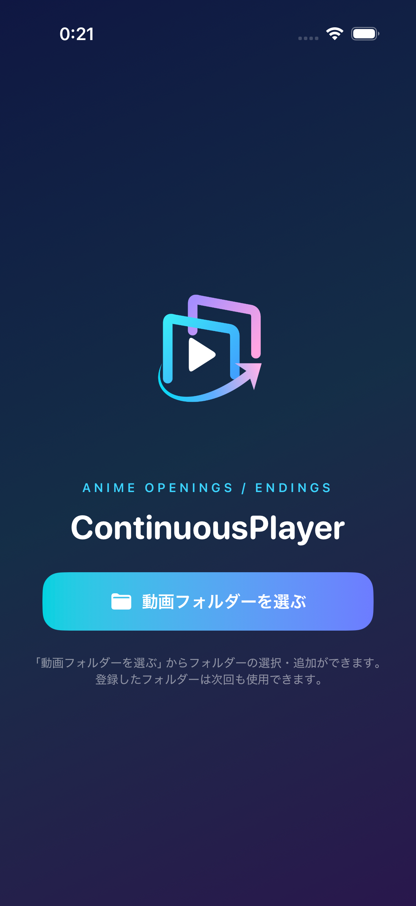
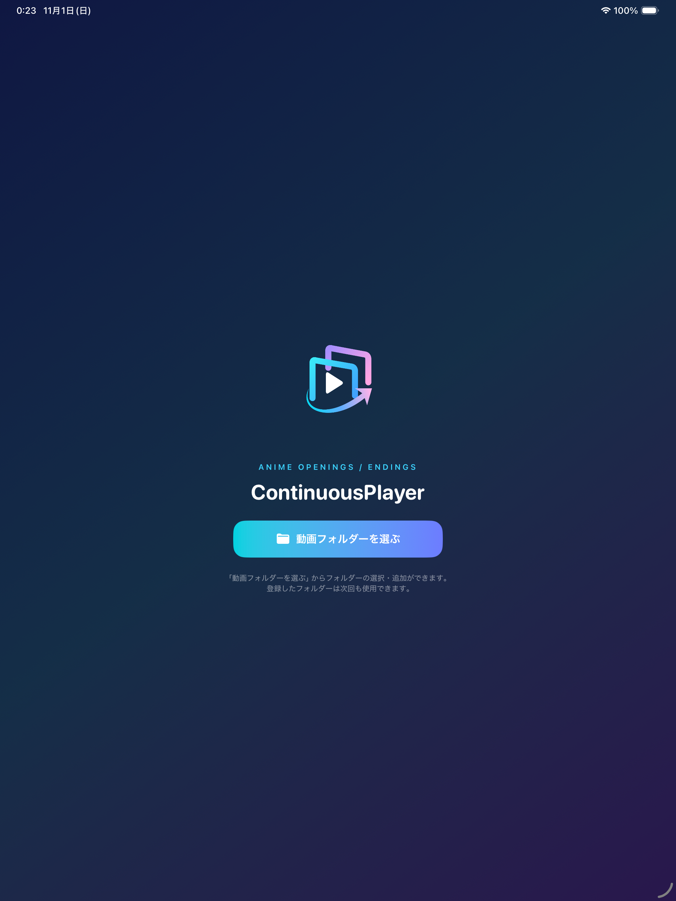
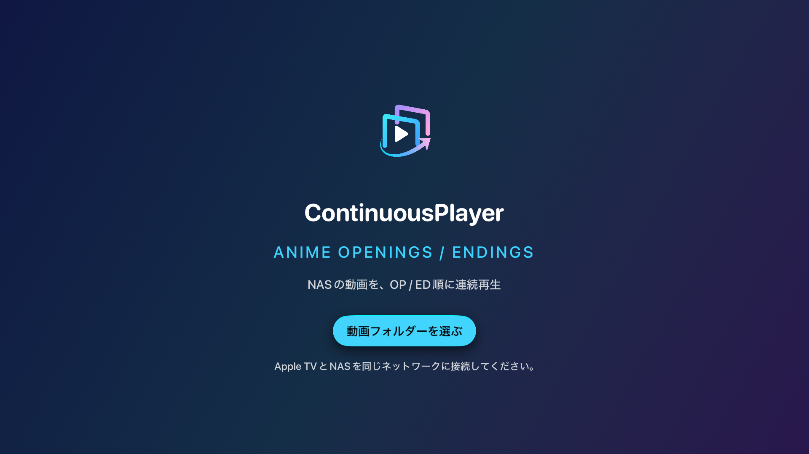
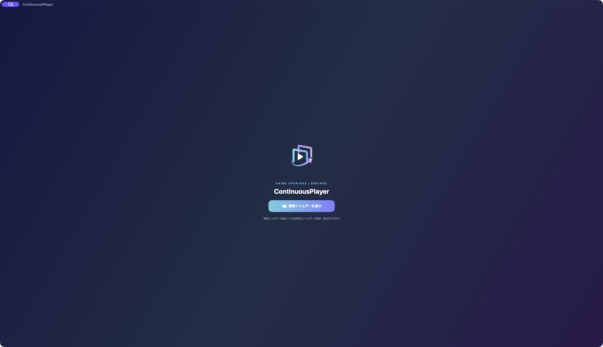
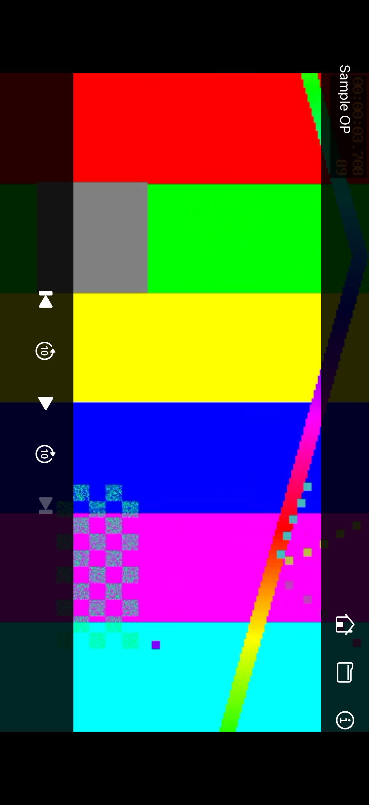
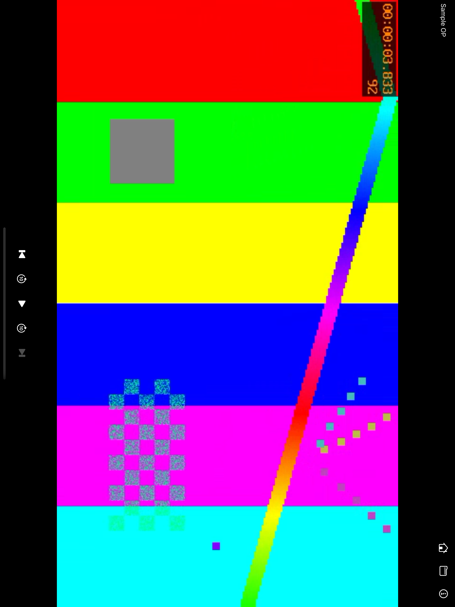
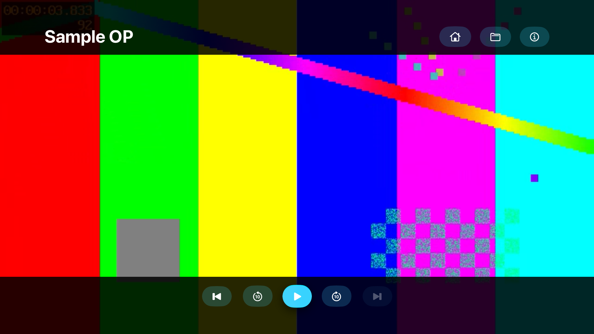
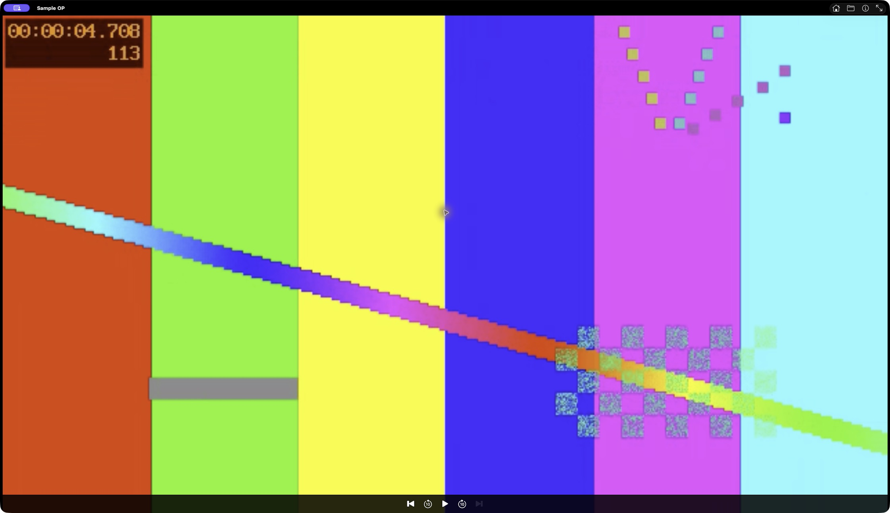

# Apple 4版のUIスナップショット — 2026年11月1日

[全プラットフォーム](README.md) · [共通操作仕様](../docs/common-operation-spec.md) · [再撮影手順](../tools/apple/README.md)

iOS・iPadOS・tvOS・Mac Catalystの**現行実装の実UIを計60枚**収録しています。4版とも[同じアプリの固定コミットa4c4040](https://github.com/mnagata/ContinuousPlayer_for_iOS/commit/a4c40408350ca1d2e0b9bee33c09f6d8bc14d5a5)を使用し、サンプルの選択・実プレイヤーの再生を撮影しました。生成モックではありません。この資料は見た目の記録であり、採用仕様や実機動作の保証とは区別します。

## 収録記録

| プラットフォーム | 撮影環境 | 枚数 | 表示条件・画像 |
|---|---|---:|---|
| [iOS / iPhone](ios/2026-11-01/README.md) | iPhone 17 Pro Simulator / iOS 26.3.1 | 16 | 縦1206×2622px、横はEXIFに従い2622×1206px表示 |
| [iPadOS / iPad](ipados/2026-11-01/README.md) | iPad Pro 13-inch (M5) Simulator / iPadOS 26.3.1 | 16 | 縦2064×2752px、横は2752×2064px表示。標準の全画面ウィンドウ |
| [tvOS / Apple TV](tvos/2026-11-01/README.md) | Apple TV 4K (3rd generation), 1080p Simulator / tvOS 27.0 | 12 | 1920×1080px、リモコン操作・フォーカス記録 |
| [Mac Catalyst](mac-catalyst/2026-11-01/README.md) | Mac arm64 / macOS 26.7 | 16 | 通常ウィンドウ2240×1292px、情報シート478×524px、解除確認260×122px |

iPhone / iPadのPNGは横向きでも格納寸法が縦で、EXIF orientation=8を持ちます。上表はEXIFに対応したビューアーでの表示寸法です。全画像の格納寸法、表示寸法、向き、SHA-256、撮影日時は各`manifest.json`に記録しています。Macは撮影ツールが返したJPEGを同寸法のPNGへ形式変換し、取得元JPEGも保存しています。

## ホームを比較する

| iOS | iPadOS |
|---|---|
|  |  |

| tvOS | Mac Catalyst |
|---|---|
|  |  |

4版ともロゴ、アプリ名、英字見出し、「動画フォルダーを選ぶ」を表示します。TVはNAS向けの説明とリモコンフォーカス、Macはネイティブのタイトルバーを含みます。

## 動画を一時停止した状態

| iOS・横向き | iPadOS・横向き |
|---|---|
|  |  |

| tvOS | Mac Catalyst |
|---|---|
|  |  |

タイトル・ホーム・一覧・情報を上端、5つの再生操作を下端に置きます。Macは上端の操作をネイティブのタイトルバーへ配置し、全画面操作も表示します。tvOSは再生ボタンにフォーカスがあります。MP4 / M4Vの2件キューの末尾を選んでいるため、次のファイルは無効です。

## 共通の収録範囲

| 画面・状態 | iOS | iPadOS | tvOS | Mac Catalyst |
|---|---|---|---|---|
| ホーム | 縦・横 | 縦・横 | 選択ボタンにフォーカス | 通常ウィンドウ |
| 保存済みフォルダー・空 / 登録あり | 収録 | 収録 | 収録 | 収録 |
| 登録解除確認 | 未収録 | 未収録 | 未収録 | 右クリック後のシート |
| フォルダー追加先・DLNA接続済み | 収録 | 収録 | 収録。保存元はDLNAのみ | 収録 |
| ファイル一覧・同名異形式 | 縦・横 | 縦・横 | 初期フォルダー行にフォーカス | 選択時・再生からの選び直し |
| 空のファイル一覧 | 未収録 | 未収録 | 未収録 | Other Folderを収録 |
| 動画再生中 / 一時停止 | 再生中は縦、一時停止は縦・横 | 再生中は縦、一時停止は縦・横 | 収録 | 収録 |
| 音声のみの再生 / 自然終了 | 収録 | 収録 | 収録 | 収録 |
| 動画のメディア情報 | 収録 | 収録 | 上部のみ。音声出力欄は未収録 | 情報シート |
| 音声のメディア情報 | 収録 | 収録 | 未収録。撮影ハーネスのフォーカス移動が未到達 | 情報シート |
| 破損メディアの再生失敗 | 収録 | 収録 | 再試行にフォーカス | 収録 |

各版の画像付きREADMEに、画面ID・状態ID・表示条件・観察を載せています。到達操作と撮影時刻はmanifest、実測フォーカスは`capture-details.json`へ保存しています。tvOSで測定対象にフォーカスがなかった場合は空文字となり、映像入力surfaceのフォーカス不在までは意味しません。

## 撮影条件と制約

動画は640×360・24fps・90秒の幾何学模様、音声は48kHz・monoの無音AACを使っています。同名MP4 / M4V、空フォルダー、2秒の終了用音声、意図的な破損ファイルをlocalhostの撮影用DLNAサーバーで提供しています。プレイヤーの状態や画面を注入せず、通常UIから選んでいます。登録はDEBUG専用の`uitests.`キーを使用しますが、最終接続先は共通設定キーをテストURLへ更新します。

今回の範囲は標準文字・暗色表示です。OSファイル選択、権限案内、実USB、実NAS、自動探索、実機、外部DAC、大きな文字、iPadの分割表示、Macの別サイズ・全画面は未収録です。未収録は未実装を意味しません。音声出力の表示値は各撮影環境の現在値です。

Macのウィンドウ画像にはOSの撮影中インジケーターとポインターが含まれます。シート画像は撮影ツールが返した領域のみで、背後のウィンドウを合成していません。ソース版・アプリバンドルのファイル別ハッシュ・撮影条件・例外は各記録に残しています。
