# iOS / iPhone UIスナップショット — 2026年11月1日

[全プラットフォーム](../../README.md) · [Apple 4版の比較入口](../../apple-2026-11-01.md) · [メタデータ](manifest.json) · [撮影時刻・フォーカス記録](capture-details.json) · [撮影結果](capture-result.txt)

固定コミットの実UIをサンプルデータで撮影した **16枚**です。生成モックではありません。見た目の記録であり、仕様の採用・準拠や実機動作の保証とは区別します。

## 収録条件

| 項目 | 値 |
|---|---|
| 撮影日時 | 2026-11-01T00:21:34+09:00 〜 2026-11-01T00:23:22+09:00（日本時間） |
| 参照版 | [a4c4040](https://github.com/mnagata/ContinuousPlayer_for_iOS/commit/a4c40408350ca1d2e0b9bee33c09f6d8bc14d5a5) / Debug / 1.0 (1) |
| 機種・OS | iPhone 17 Pro / iOS 26.3.1 (23D8133) |
| ビルド環境 | Xcode 27.1 (27A9275)、arm64。製品ソースは固定コミットと一致 |
| 入力・撮影 | XCUITestによるタップ・Spaceキー・端末回転。XCUIScreen.main.screenshot → XCTAttachment → xcresulttool export attachments（PNGをそのままコピー） |
| 言語・文字 | アプリja / ja_JP、標準文字。OS全体の優先言語は未測定 |
| 寸法・ハッシュ | 画像ごとの格納px寸法・表示px寸法・EXIF向き・SHA-256をmanifestへ記録 |

## サンプルと画面遷移

640×360・24fps・90秒のtestsrc2動画（音声なし）、48kHz・mono無音AACのみのMP4（90秒 / 2秒）、意図的な破損MP4、空の子フォルダー、同名異形式M4V/MP4。

ホーム → 保存済み → フォルダーを追加 → DLNAサーバー → UI Sample NAS → このフォルダーを登録 → 保存済み行 → ファイル一覧 → 再生、の通常UI経路で撮影しました。サーバー接続先とテスト登録の初期化だけを起動引数で準備し、プレイヤーの状態や画面を注入していません。

動画はSpace / Play-Pauseで一時停止して情報を開きます。音声・終了・エラーは接続先をaudio.xml / end.xml / failure.xmlへ切り替えた別キューです。登録は`uitests.`専用キーですが、DLNA最終接続先は共通設定キーをテストURLへ更新します。

横向き画像はPNGの格納サイズが縦のままで、EXIF orientation=8を持ちます。対応ビューアーでは横向き表示となり、回転・リサイズ加工はしていません。iPadの一覧・情報はシートとして表示され、背後の再生画面を含みます。

## ホーム

### ホーム / landscape

`home/default` · PNG格納 1206×2622px · 表示 2622×1206px

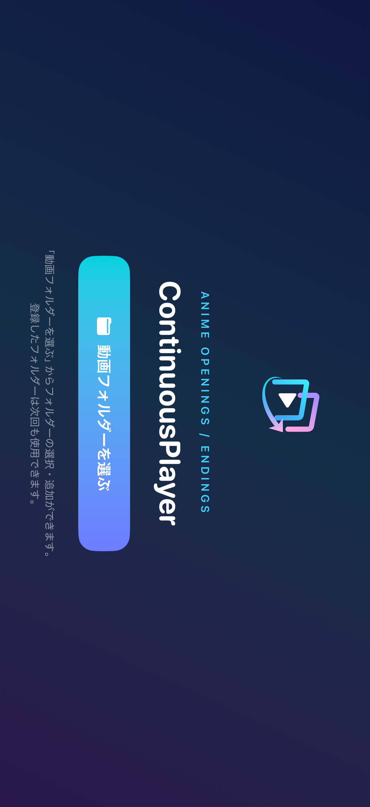

ロゴ、ANIME OPENINGS / ENDINGS、ContinuousPlayer、「動画フォルダーを選ぶ」を表示する。

### ホーム / portrait

`home/default` · PNG格納 1206×2622px · 表示 1206×2622px

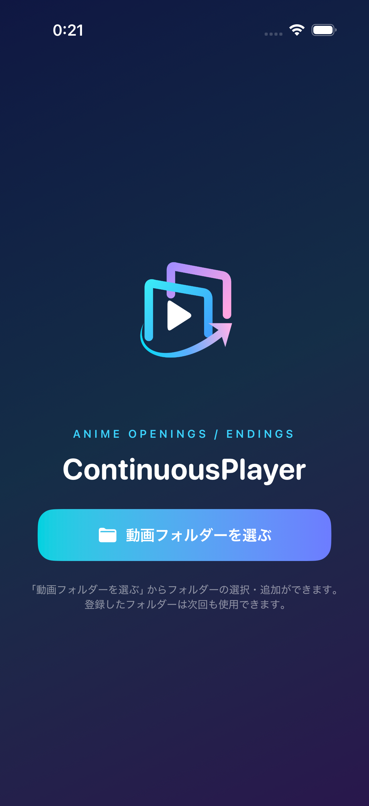

ロゴ、ANIME OPENINGS / ENDINGS、ContinuousPlayer、「動画フォルダーを選ぶ」を表示する。

## フォルダーの選択・登録

### フォルダーの追加先 / portrait

`add-source/default` · PNG格納 1206×2622px · 表示 1206×2622px

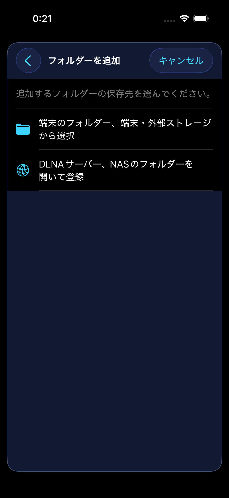

保存元の選択画面。tvOSはDLNA、ほかの3版は端末・外部ストレージとDLNAの入口を表示する。

### DLNAサーバー・サンプル接続済み / portrait

`dlna-servers/populated` · PNG格納 1206×2622px · 表示 1206×2622px

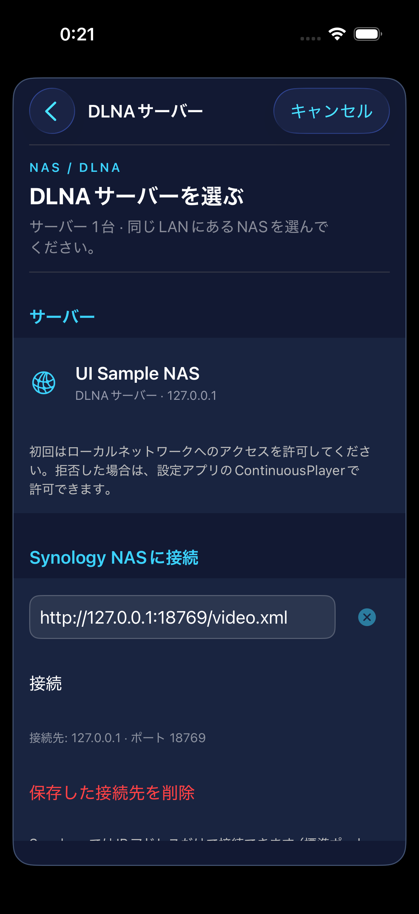

UI Sample NAS、ループバックの接続先、接続操作を表示する。自動探索は撮影引数で無効化している。

### 保存済みフォルダー・未登録 / portrait

`saved-folders/empty` · PNG格納 1206×2622px · 表示 1206×2622px

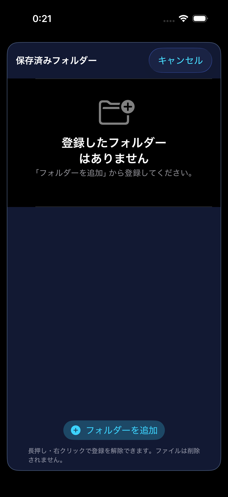

未登録の案内と「フォルダーを追加」を表示する。

### 保存済みフォルダー・登録あり / portrait

`saved-folders/populated` · PNG格納 1206×2622px · 表示 1206×2622px

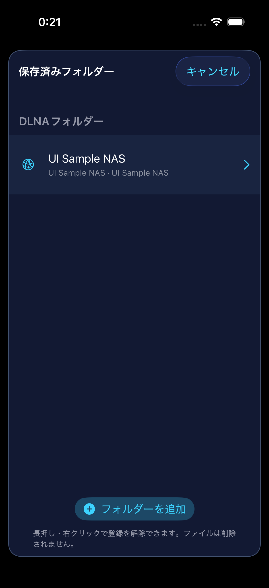

DLNAフォルダーにUI Sample NASの登録行を表示する。

## ファイル一覧

### 再生開始ファイルの選択 / landscape

`file-browser/populated` · PNG格納 1206×2622px · 表示 2622×1206px

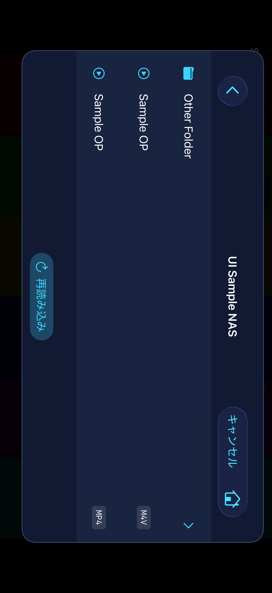

Other Folderと同名Sample OPの2形式を表示し、M4V / MP4の形式バッジで区別する。

### 再生開始ファイルの選択 / portrait

`file-browser/populated` · PNG格納 1206×2622px · 表示 1206×2622px

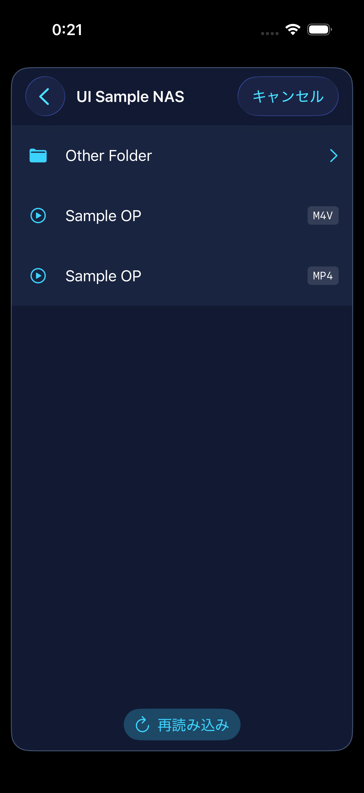

Other Folderと同名Sample OPの2形式を表示し、M4V / MP4の形式バッジで区別する。

## 再生画面

### 音声のみの再生中 / portrait

`player/audio-playing` · PNG格納 1206×2622px · 表示 1206×2622px

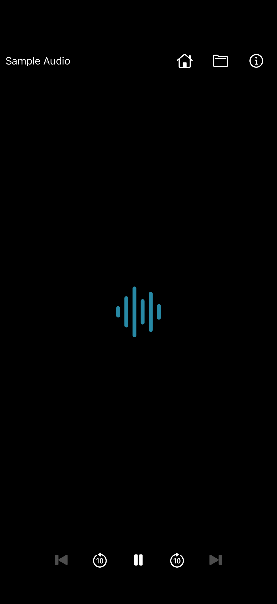

黒背景中央に波形アイコンを表示し、再生中も上下の操作部を表示する。

### フォルダーの再生終了 / portrait

`player/ended` · PNG格納 1206×2622px · 表示 1206×2622px

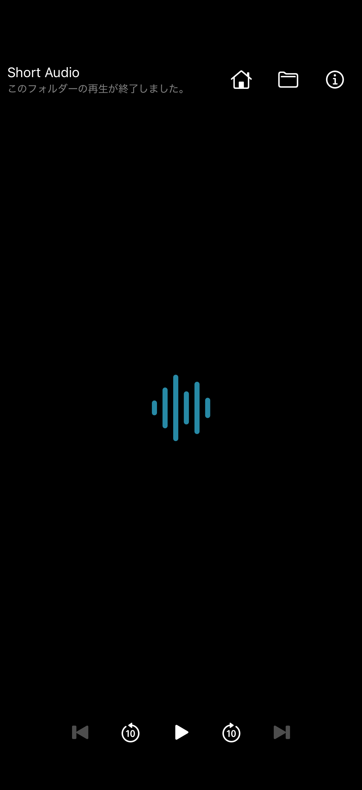

Short Audioとフォルダーの再生終了メッセージ、再生ボタンを表示する。

### 動画一時停止 / landscape

`player/video-paused` · PNG格納 1206×2622px · 表示 2622×1206px

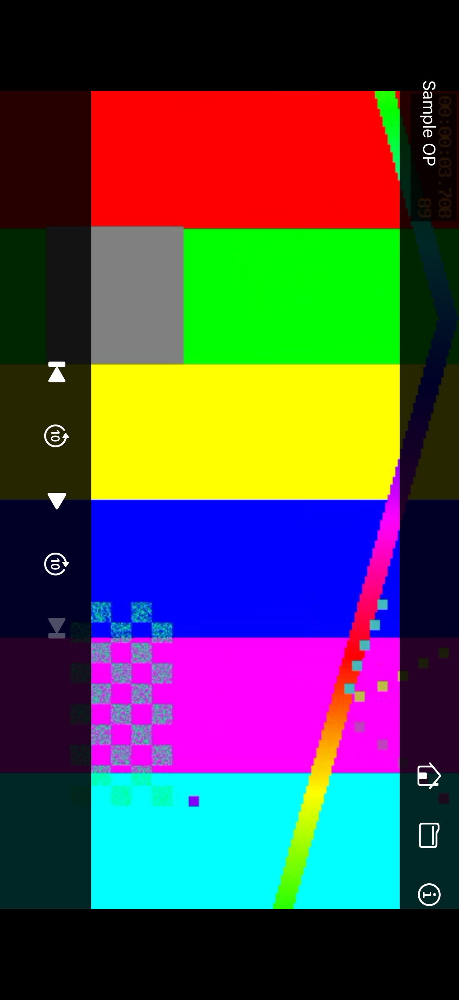

上端にタイトルとホーム・一覧・情報、下端に前・−10秒・再生・＋10秒・次の5操作を表示する。選択したMP4は2件キューの末尾で、次は無効。

### 動画一時停止 / portrait

`player/video-paused` · PNG格納 1206×2622px · 表示 1206×2622px

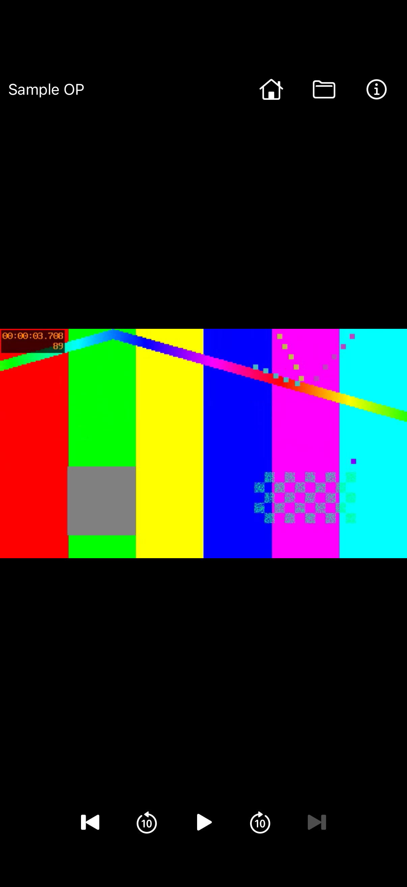

上端にタイトルとホーム・一覧・情報、下端に前・−10秒・再生・＋10秒・次の5操作を表示する。選択したMP4は2件キューの末尾で、次は無効。

### 動画再生中 / portrait

`player/video-playing` · PNG格納 1206×2622px · 表示 1206×2622px

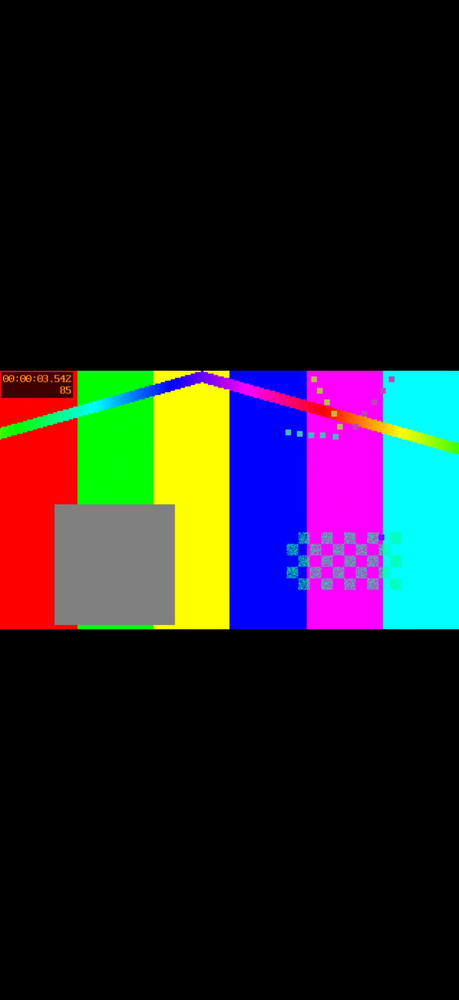

640×360・24fpsの合成テスト映像を表示する。再生操作部は隠れている。

## メディア情報

### 音声のメディア情報 / portrait

`media-info/audio` · PNG格納 1206×2622px · 表示 1206×2622px

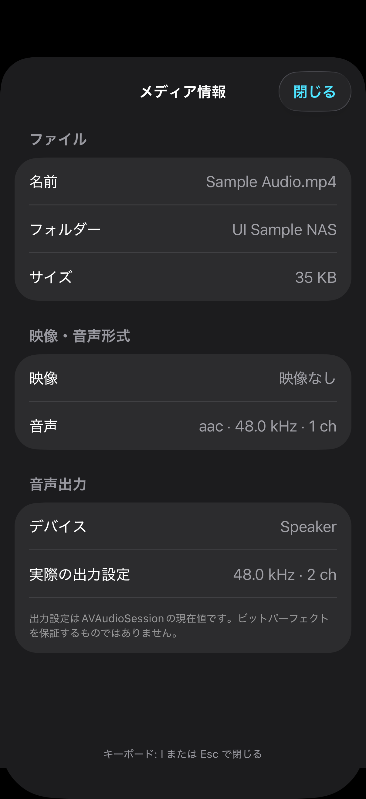

元のファイル名Sample Audio.mp4、映像なし、AAC・48kHz・1chと、環境の音声出力情報を表示する。

### 動画のメディア情報 / portrait

`media-info/video` · PNG格納 1206×2622px · 表示 1206×2622px

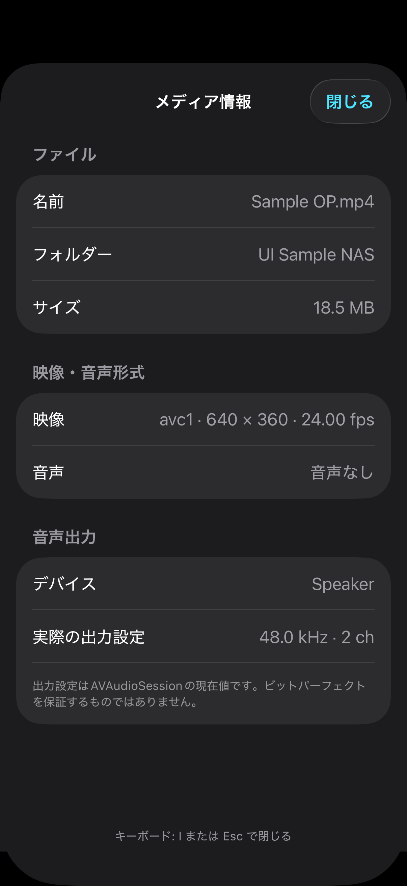

元のファイル名Sample OP.mp4、サイズ、avc1・640×360・24fps、音声なしを表示する。

## 再生失敗

### 破損メディアの再生失敗 / portrait

`playback-error/decode` · PNG格納 1206×2622px · 表示 1206×2622px

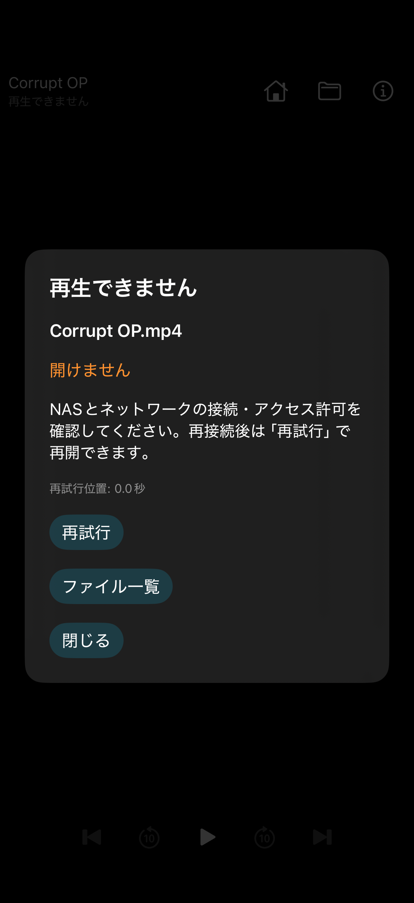

Corrupt OP.mp4に対して「再生できません」「開けません」、再試行・ファイル一覧・閉じるを表示する。失敗原因の分類や復旧成功は画像だけでは判定しない。

## 未収録・対象外

| 対象 | 状態 | 理由 |
|---|---|---|
| `system-picker/default,permission/default` | pending | OSファイル選択・権限案内・USBストレージ接続は収録していない。 |
| `dlna-servers/empty,manual-entry,connection-error` | pending | DLNAはlocalhostへの接続済み画面のみ。自動探索・実LANの失敗・入力中は未収録。 |
| `file-browser/loading,failure` | pending | 撮影用サーバーは即時応答。読み込み中・一覧取得失敗は未収録。 |
| `accessibility,additional-window-sizes,real-devices` | pending | 大きな文字、VoiceOver、別サイズ、実機、実NAS、実USB DAC、中断復帰の表示は未収録。 |
| `saved-folders/remove-confirmation,file-browser/empty` | pending | この撮影ハーネスでは未収録。Mac Catalystの画像を代用しない。 |
| `player/video-playing-landscape,media-info/landscape` | pending | 横向きはホーム・ファイル一覧・動画一時停止を収録。ほかの横向き状態は未収録。 |

未収録は未実装を意味しません。撮影の制約は[manifest.json](manifest.json)の`limitations`にも記録しています。

## 再現と根拠

- [Apple版の再撮影手順](../../../tools/apple/README.md)
- [共通操作仕様](../../../docs/common-operation-spec.md)
- [固定コミットの画面定義](https://github.com/mnagata/ContinuousPlayer_for_iOS/tree/a4c40408350ca1d2e0b9bee33c09f6d8bc14d5a5/ContinuousPlayer_for_iOS)
- [固定コミットのtvOS画面定義](https://github.com/mnagata/ContinuousPlayer_for_iOS/tree/a4c40408350ca1d2e0b9bee33c09f6d8bc14d5a5/ContinuousPlayer_for_tvOS)
