# Windows UIスナップショット — 2026年11月3日

[全プラットフォーム](../../README.md) · [メタデータ](manifest.json) · [撮影記録](capture-details.json) · [ビルド成果物のハッシュ一覧](artifact-files.json) · [再現手順](../../../tools/windows/README.md)

固定コミットの実UIをサンプルデータで撮影した **16枚**です。画像は撮影時点の見た目を記録し、仕様への準拠や実機動作の保証とは区別します。

## 収録条件

| 項目 | 値 |
|---|---|
| 撮影日時 | 2026-11-03T19:15:43+09:00 〜 2026-11-03T19:19:36+09:00（画像保存時刻） |
| 参照版 | [5aeed39](https://github.com/mnagata/ContinuousPlayer_for_Win/commit/5aeed393d93c09a4a572bd3d9c01263f2bb538aa) / Debug / x64 / 1.0.0.0 |
| 製品ソース | 参照コミットと一致。撮影用レイアウトのパッケージIDだけを変更 |
| 実行環境 | Windows PC、NT 10.0 build 26300.9818 / 26H2、ローカル実行 |
| ビルド環境 | .NET SDK 11.0.100-rc.3.26522.148 / .NET 10.0.14 / Windows App SDK 2.5.1 / WinApp CLI 0.7.1 |
| 画像・ウィンドウ | 全画像1026×610px、タイトルバーと枠を含む。DIP寸法・DPI・文字倍率は未測定 |
| 言語・外観 | アプリは日本語、OSカルチャーja-JP、暗色。倍率の上書きなし |
| 入力・撮影 | Computer Useのポインター操作。ウィンドウJPEG原本を保存し、System.Drawingで同寸法PNGへ変換 |

## サンプルと画面遷移

120秒の単色MP4、90秒と2秒の無音PCM WAV、意図的な破損MP4、空の子フォルダーを使用しました。撮影専用ID `ContinuousPlayer.UISnapshots` を使い、通常版と保存領域を分離しています。初回は登録0件、続いて専用の `library.json` にローカル2件だけを準備して再起動しました。登録操作そのものの検証ではありません。

ホーム → 保存済み → Sample Media → Empty → 親へ → Sample OPの再生 → 一時停止 → 動画情報 → 次の音声 → 再生 → 音声情報 → 再生元一覧 → Corruptの再生エラー → 保存済み → 登録解除確認 → 閉じる → End Sample → 再生終了 → 音声出力設定、の通常UI経路で撮影しました。追加先選択は登録0件の状態から開きました。

実NAS・個人メディア・外部DACは使用していません。登録解除と設定保存は実行せず、撮影用パッケージは撮影後に削除しました。

## 画面一覧

| 画面ID | 状態ID | variant | 内容 |
|---|---|---|---|
| `home` | `default` | `desktop-window` | [ホーム](images/home--default--desktop-window.png) |
| `saved-folders` | `empty` | `desktop-window` | [保存済みフォルダー・未登録](images/saved-folders--empty--desktop-window.png) |
| `add-source` | `default` | `desktop-window` | [フォルダーの追加先](images/add-source--default--desktop-window.png) |
| `saved-folders` | `populated` | `desktop-window` | [保存済みフォルダー・登録あり](images/saved-folders--populated--desktop-window.png) |
| `file-browser` | `empty` | `desktop-window` | [ファイル一覧・空フォルダー](images/file-browser--empty--desktop-window.png) |
| `file-browser` | `populated` | `desktop-window` | [ファイル一覧・サンプルあり](images/file-browser--populated--desktop-window.png) |
| `player` | `video-playing` | `desktop-window` | [動画・再生中](images/player--video-playing--desktop-window.png) |
| `player` | `video-paused` | `desktop-window` | [動画・一時停止](images/player--video-paused--desktop-window.png) |
| `media-info` | `video` | `desktop-window` | [メディア情報・動画](images/media-info--video--desktop-window.png) |
| `player` | `audio-playing` | `desktop-window` | [音声・再生中](images/player--audio-playing--desktop-window.png) |
| `media-info` | `audio` | `desktop-window` | [メディア情報・音声](images/media-info--audio--desktop-window.png) |
| `file-browser` | `populated` | `desktop-playback-overlay` | [再生元ファイル一覧](images/file-browser--populated--desktop-playback-overlay.png) |
| `playback-error` | `decode` | `desktop-window` | [再生エラー・破損MP4](images/playback-error--decode--desktop-window.png) |
| `saved-folders` | `remove-confirmation` | `desktop-window` | [フォルダーの登録解除確認](images/saved-folders--remove-confirmation--desktop-window.png) |
| `player` | `ended` | `desktop-window` | [再生終了](images/player--ended--desktop-window.png) |
| `windows-audio-settings` | `default` | `desktop-window` | [音声出力設定・標準](images/windows-audio-settings--default--desktop-window.png) |

## 収録画像

### ホーム

`home/default` · `desktop-window` · 1026×610px

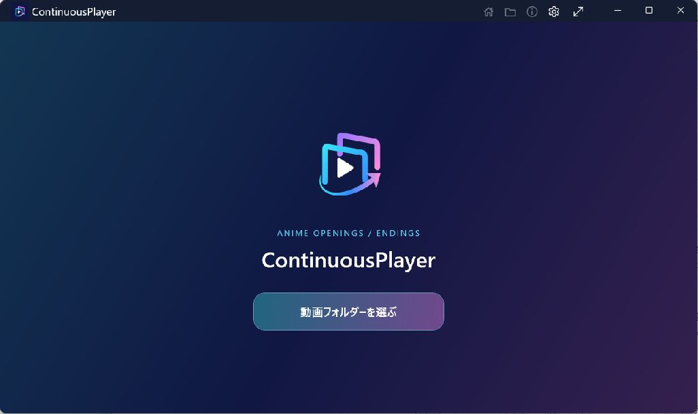

ロゴ、英字見出し、アプリ名、動画フォルダーを選ぶボタン。

到達手順：撮影専用パッケージを起動。

### 保存済みフォルダー・未登録

`saved-folders/empty` · `desktop-window` · 1026×610px

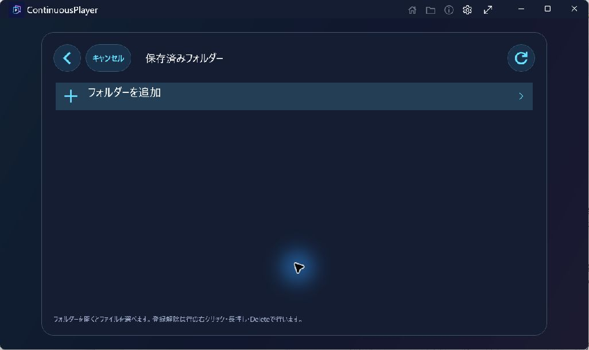

フォルダーを追加の行のみを表示。

到達手順：ホーム → 動画フォルダーを選ぶ。

### フォルダーの追加先

`add-source/default` · `desktop-window` · 1026×610px

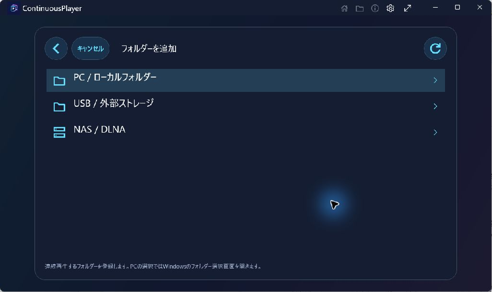

PC / ローカルフォルダー、USB / 外部ストレージ、NAS / DLNAの3つの入口。

到達手順：保存済みフォルダー → フォルダーを追加。

### 保存済みフォルダー・登録あり

`saved-folders/populated` · `desktop-window` · 1026×610px

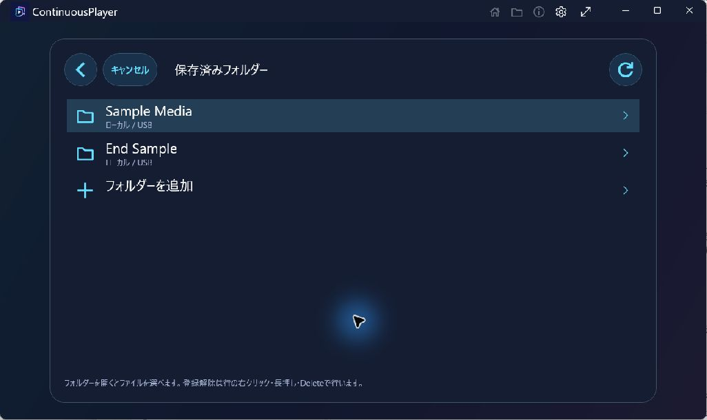

2件のローカル登録とフォルダーを追加の行。

到達手順：ホーム → 動画フォルダーを選ぶ。

### ファイル一覧・空フォルダー

`file-browser/empty` · `desktop-window` · 1026×610px

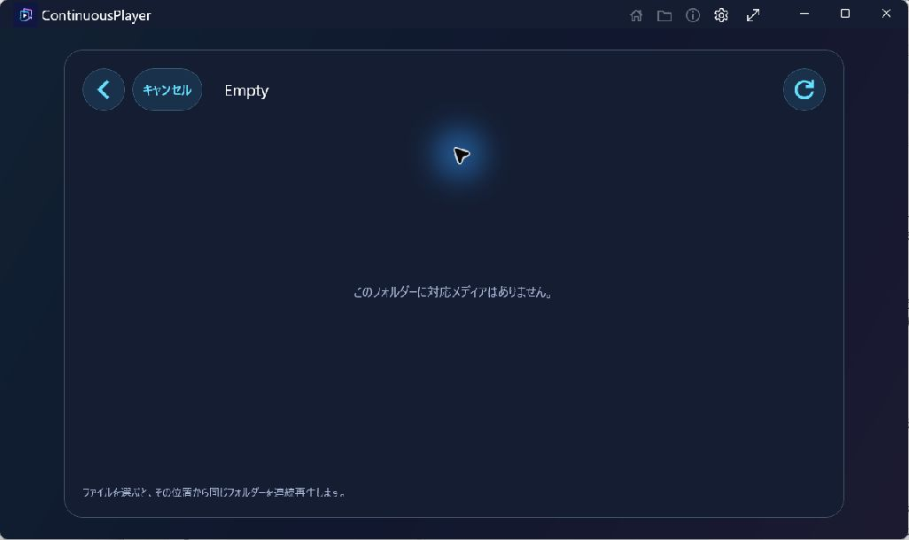

このフォルダーに対応メディアはありません、と表示。

到達手順：保存済み → Sample Media → Empty。

### ファイル一覧・サンプルあり

`file-browser/populated` · `desktop-window` · 1026×610px

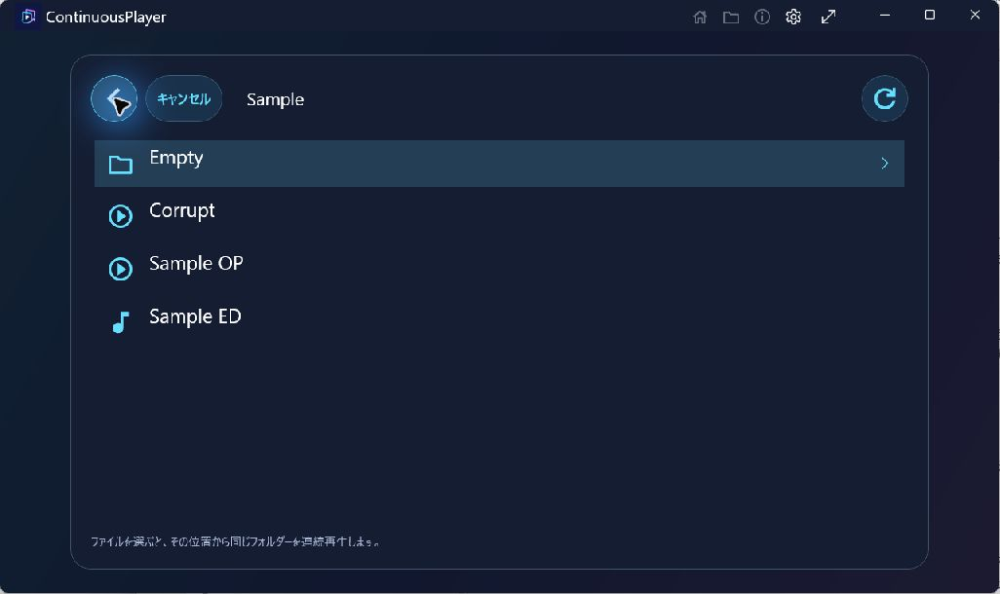

フォルダー、動画、音声のアイコン。対応拡張子を省略してCorrupt、Sample OP、Sample EDを表示。

到達手順：Empty → 上のフォルダー。

### 動画・再生中

`player/video-playing` · `desktop-window` · 1026×610px

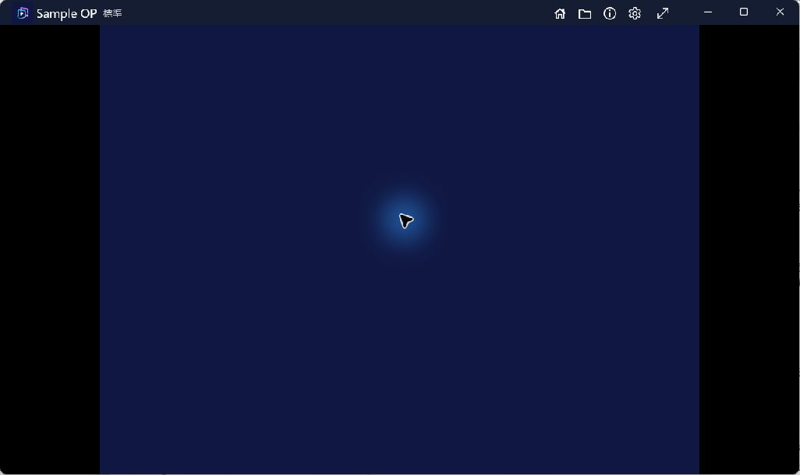

タイトルバーにSample OPと標準。下部操作部を隠し、青い4:3映像と左右の黒帯を表示。

到達手順：ファイル一覧 → Sample OPを選択して再生開始。

### 動画・一時停止

`player/video-paused` · `desktop-window` · 1026×610px

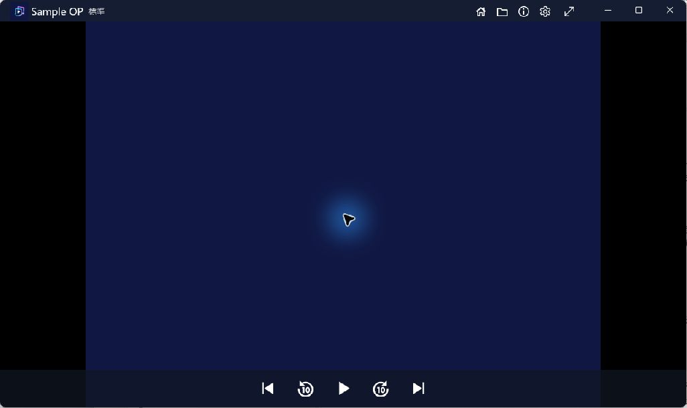

下部に前・10秒戻す・再生・10秒進める・次の操作部。

到達手順：再生面をクリックして一時停止。

### メディア情報・動画

`media-info/video` · `desktop-window` · 1026×610px

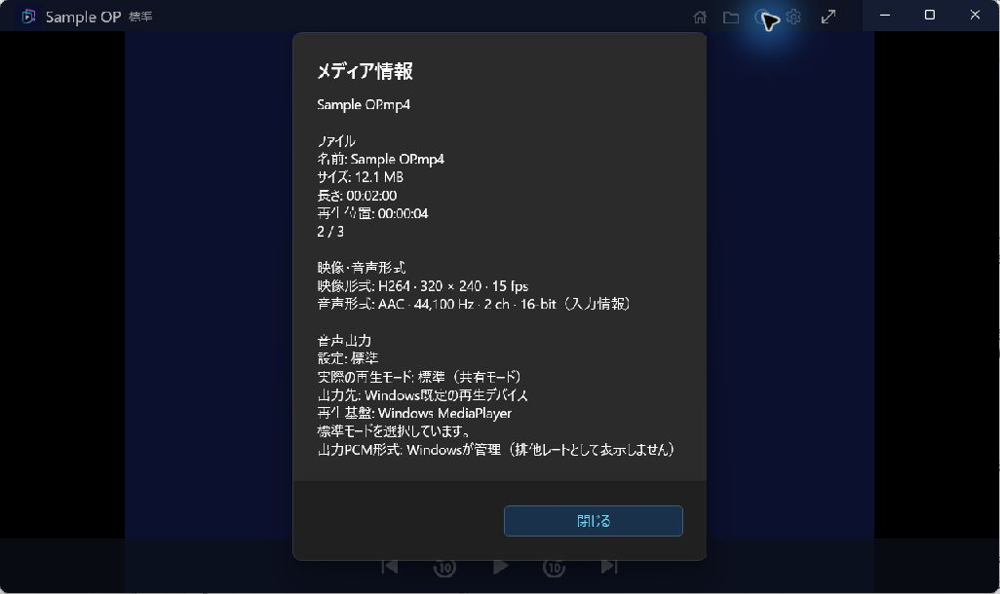

H264、320×240、15fps、AAC、44,100Hz、2ch、標準共有モードなどを表示。

到達手順：タイトルバーのメディア情報を選択。

### 音声・再生中

`player/audio-playing` · `desktop-window` · 1026×610px

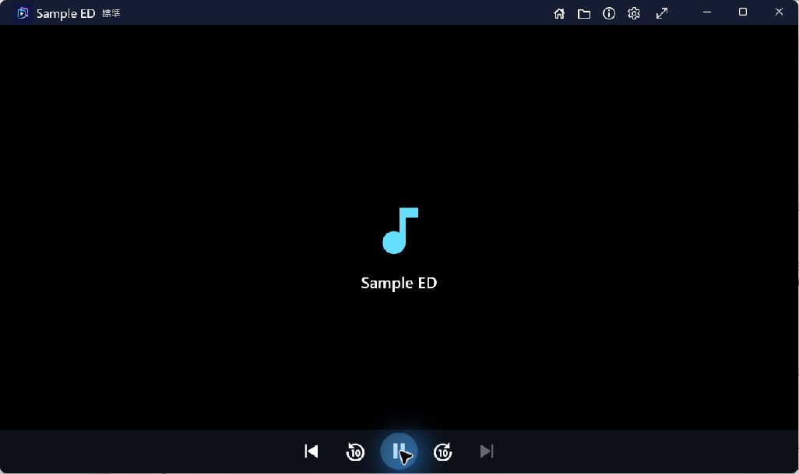

音符と曲名、下部の一時停止ボタン。末尾の曲のため次のボタンは無効。

到達手順：動画情報を閉じる → 次のファイル → 再生。

### メディア情報・音声

`media-info/audio` · `desktop-window` · 1026×610px

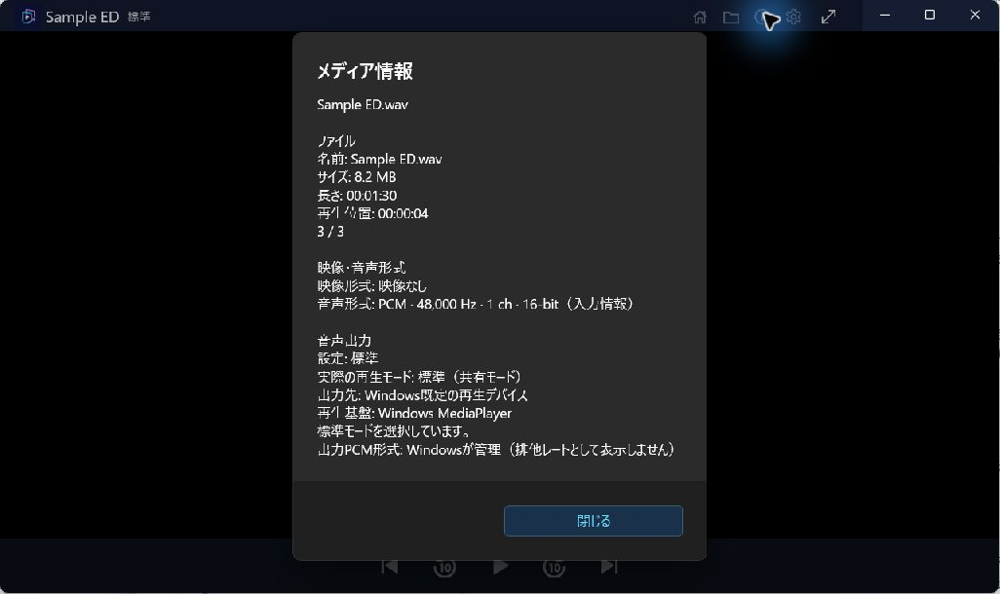

映像なし、PCM、48,000Hz、1ch、16-bit、Windows MediaPlayerと標準共有モードを表示。

到達手順：タイトルバーのメディア情報を選択。

### 再生元ファイル一覧

`file-browser/populated` · `desktop-playback-overlay` · 1026×610px

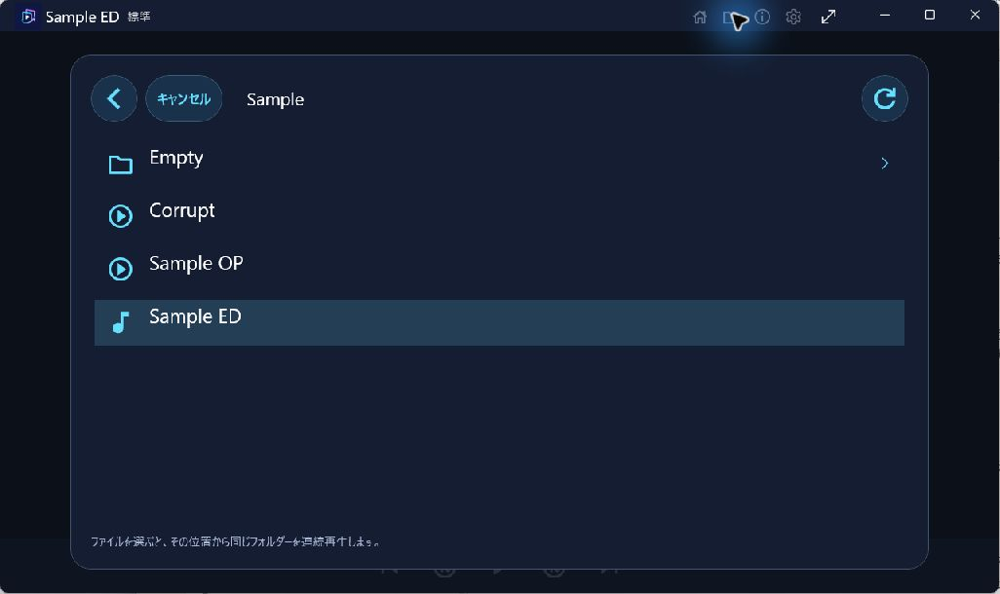

再生画面上の一覧。Sample EDの行が選択されている。

到達手順：タイトルバーのファイル一覧を選択。

### 再生エラー・破損MP4

`playback-error/decode` · `desktop-window` · 1026×610px

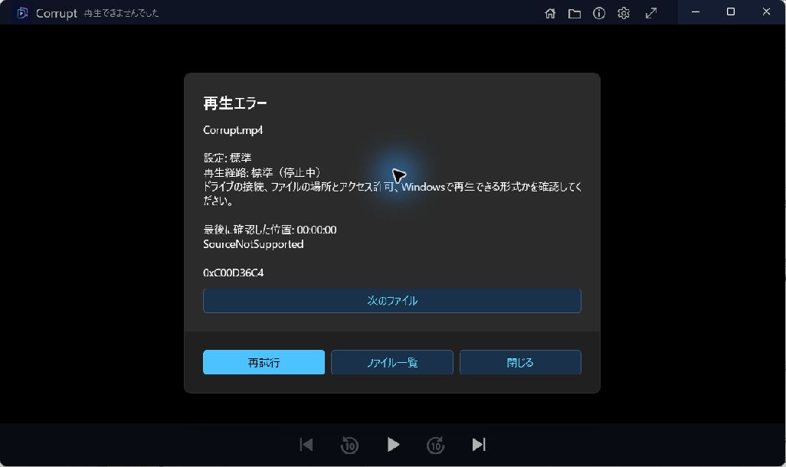

原因案内、SourceNotSupported、0xC00D36C4、再試行・次のファイル・ファイル一覧・閉じる。

到達手順：再生元一覧でCorruptを選択。

### フォルダーの登録解除確認

`saved-folders/remove-confirmation` · `desktop-window` · 1026×610px

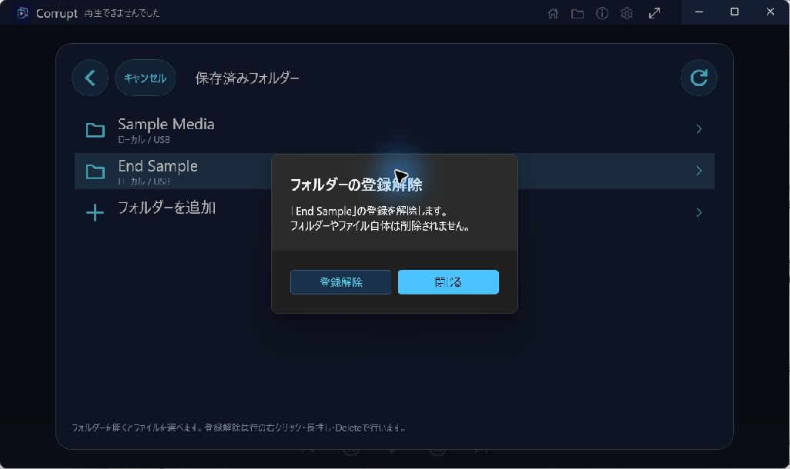

End Sampleの登録解除確認。実ファイルは削除しない旨と、登録解除・閉じる。

到達手順：保存済み一覧でEnd Sampleを右クリック。

### 再生終了

`player/ended` · `desktop-window` · 1026×610px

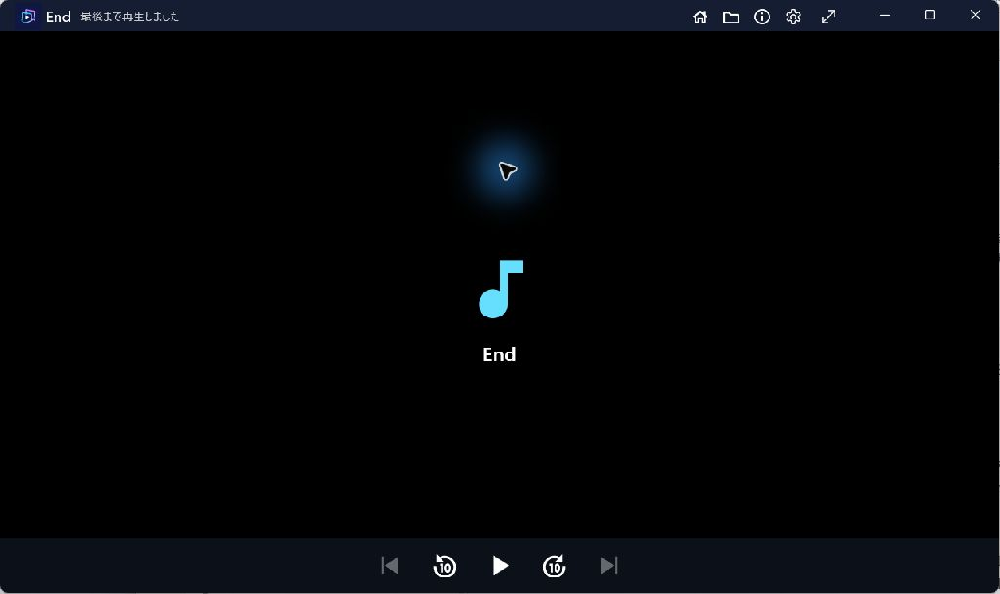

タイトルバーに最後まで再生しました。再生ボタンと無効な前・次ボタン。

到達手順：解除確認を閉じる → End Sample → Endを選択して末尾まで待つ。

### 音声出力設定・標準

`windows-audio-settings/default` · `desktop-window` · 1026×610px

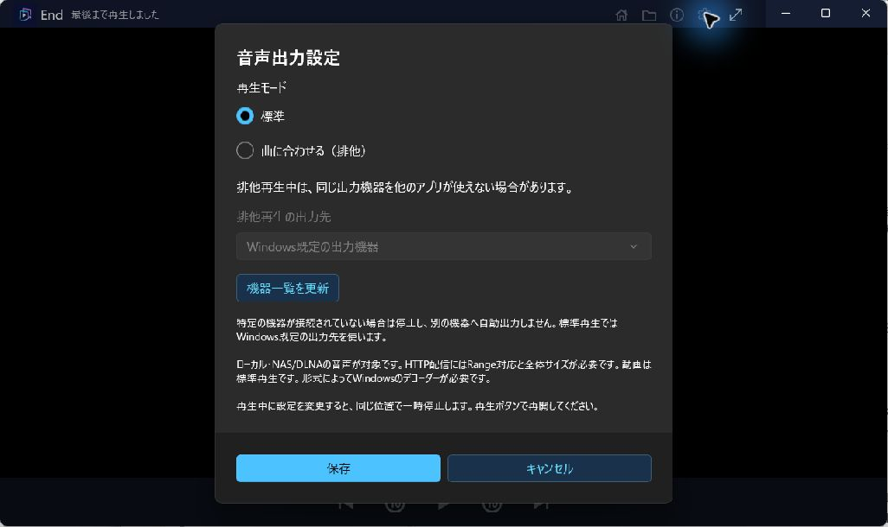

標準と曲に合わせる（排他）、出力先、機器一覧を更新、注意説明、保存・キャンセル。

到達手順：再生終了画面 → タイトルバーの音声出力設定。

## 未収録・制約

| 対象 | 状態 | 理由 |
|---|---|---|
| `file-browser/loading,failure` | `pending` | 通常一覧と空フォルダーのみ。遅延取得・アクセス失敗は未収録。 |
| `dlna-servers/*` | `pending` | 個人のNASやネットワーク情報を収録しないため探索・接続は未実施。次回はループバックのサンプルサーバーを用意する。 |
| `system-picker/default,permission/default` | `pending` | 登録の初期状態は撮影専用の保存ファイルで準備。OSフォルダー選択・権限案内は未収録。 |
| `windows/fullscreen,light,high-contrast,large-font,touch` | `pending` | 今回の対象は初期サイズの暗色ウィンドウとポインター入力のみ。 |
| `player/artwork,exclusive-output,usb-dac,interruptions` | `pending` | 標準共有モード、ジャケットなしの音声のみ。外部機器・割り込み・排他再生は未収録。 |

JPEG原本は `source-jpeg/` に残し、PNGは同寸法の形式変換だけを行っています。JPEG由来の圧縮を含み、PNG直接撮影とは区別します。切り抜き・合成・注釈・リサイズはありません。ポインターと周囲の青い強調表示は撮影環境由来です。DPI・文字倍率・DIP寸法・画像ごとのフォーカス要素は独立測定していないため、manifestではnullです。

## 検証

16枚の元画像を目視確認し、PNGの寸法、ハッシュ、画面・状態ID、JPEG原本との対応、画像リンクを確認しています。再検証は共通リポジトリのルートで次を実行します。

```powershell
pwsh -File tools/windows/Test-Capture.ps1
```

再現用のサンプル準備・ビルド・撮影方法は[Windows撮影手順](../../../tools/windows/README.md)を参照してください。
